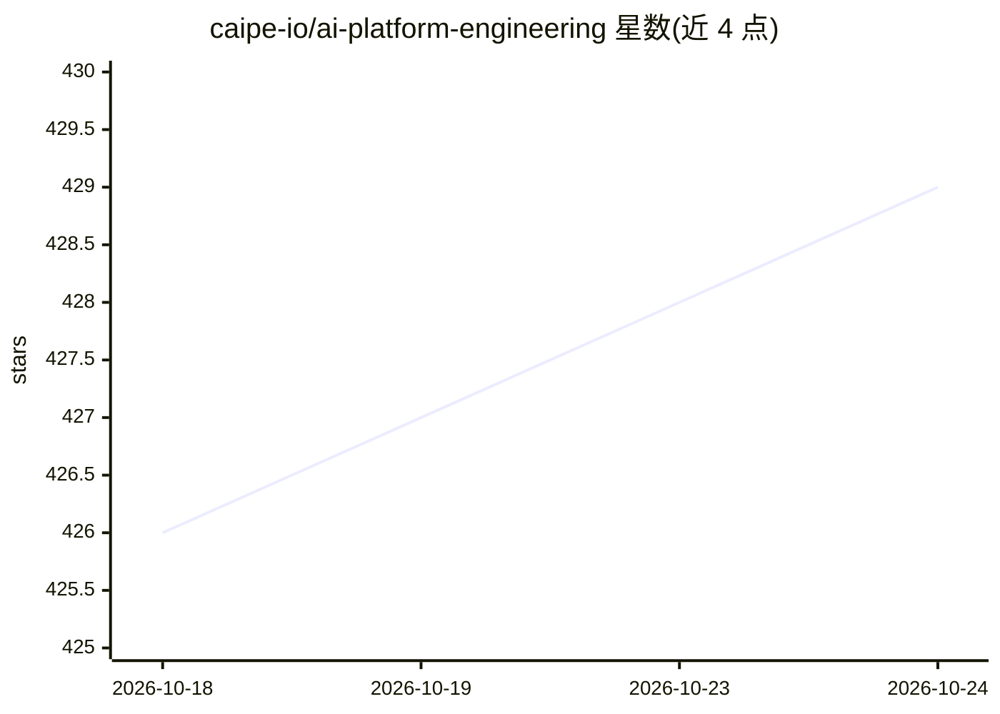

# caipe-io/ai-platform-engineering

⭐ 429 · TypeScript · Apache-2.0 · 推送 2026-10-23 · [GitHub](https://github.com/caipe-io/ai-platform-engineering) · [官网](https://caipe.io) · 组织维护

**构建、治理与运行 AI agent 及工作流的开源平台**

CAIPE 是面向平台工程的开源 AI 平台，定位为构建、部署、治理与运行 AI agent 及 agentic workflow 的集成平台，覆盖 agent 创建、运行时执行、工作流自动化、技能与 MCP 集成、企业知识、身份与授权、可观测性及多渠道体验。项目采用 Apache-2.0 许可，通过每周例会、CNCF Slack 频道与贡献指南组织社区协作。README 处于早期社区建设阶段，未给出安装或运行步骤。

## 筛选速览

| 维度 | 判定 | 备注 |
|---|---|---|
| AI 角色 | `ai-ecosystem` | LLM/agent 周边工具 |
| 许可风险 | `permissive` | Apache-2.0 |
| 部署形态 | `None` |  |
| 模型依赖 | — | README 未给出锁定关系 |
| 硬件要求 | — | 无带数字的原话,不猜 |
| 安装摩擦 | `low` | 无编译、无系统依赖或容器化 |
| 成熟度 | — | 结构信号不足 |

## 能力要点

- 覆盖 agent 创建、运行时执行与工作流自动化
- 支持技能与 MCP 集成、企业知识、身份与授权、可观测性
- 多渠道体验与治理能力纳入平台范围
- Apache-2.0 许可，社区通过每周例会与 Slack 运作

## 适用场景

- 为企业搭建统一构建与运行 AI agent 的平台
- 对 agent 与工作流进行治理与可观测性管理
- 通过 MCP 与技能体系扩展 agent 能力

## 场景标签

`Agent 框架` `多智能体` `工作流自动化` `LLM 可观测性` · 领域:Agent 开发

## 证据(README 行号)

> L9: **CAIPE** (pronounced like *cape* 🦸) is an open-source AI platform for building, deploying, governing, and operating

## 星数曲线

2026-10-18 426 → 2026-10-24 429（+3）

---
*卡片 v1 · prompt 1.4 · 生成 2026-10-21 · 置信度 mid · 依据 README sha `03c1047c0c33` · [字段定义](../../DATASET.md)*
