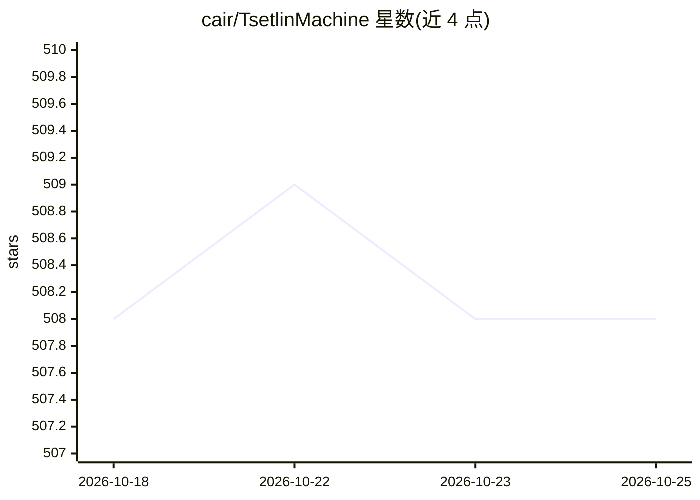

# cair/TsetlinMachine

⭐ 508 · Cython · MIT · 推送 2026-02-10 · [GitHub](https://github.com/cair/TsetlinMachine) · [官网](https://arxiv.org/abs/1804.01508) · 组织维护

**Tsetlin Machine 原始实现：用可解释命题公式做模式识别的机器学习代码与数据集**

实现 2018 年 arXiv 论文中的 Tsetlin Machine 及其多分类版本：以布尔特征为输入，通过 Tsetlin Automata 集体强化学习组合出合取子句，经求和与阈值投票产生分类决策，形成易解释的命题逻辑模式。学习为在线方式，逐个处理训练样本，含 Type I/II 反馈与资源配置动态。README 附 Noisy XOR 演示脚本、MNIST 学习行为说明，并罗列多语言其他实现、相关架构、论文、书籍与视频教程。要求 Python 2.7.x、NumPy 与 Cython。

## 筛选速览

| 维度 | 判定 | 备注 |
|---|---|---|
| AI 角色 | `ai-native` | 本体是模型或模型工具 |
| 许可风险 | `permissive` | MIT |
| 部署形态 | `library` | 以包/库形式分发 |
| 模型依赖 | — | README 未给出锁定关系 |
| 硬件要求 | — | 无带数字的原话,不猜 |
| 安装摩擦 | `medium` | 含编译或系统依赖之一 |
| 成熟度 | — | 结构信号不足 |

## 能力要点

- 以 Tsetlin Automata 集体学习组合命题公式进行二分类/多分类
- 在线学习，逐样本处理，含 Type I/II 强化反馈机制
- 提供 Noisy XOR 演示脚本，附 MNIST 数据集学习行为说明
- 汇总十余种语言/硬件的其他实现与相关扩展架构

## 适用场景

- 研究可解释命题逻辑式机器学习方法
- 复现论文中的 Noisy XOR 与 MNIST 实验
- 作为 Tsetlin Machine 系列算法的参考实现进行学习与实验

## 场景标签

 · 领域:机器学习/模式识别

## 证据(README 行号)

> L4: Code and datasets for the Tsetlin Machine. Implements the Tsetlin Machine from https://arxiv.org/abs/1804.01508, inc
> L61: ```bash

## 星数曲线



2026-10-18 508 → 2026-10-25 508（+0）


---
*卡片 v1 · prompt 1.4 · 生成 2026-10-21 · 置信度 mid · 依据 README sha `bc406c624a32` · [字段定义](../../DATASET.md)*
