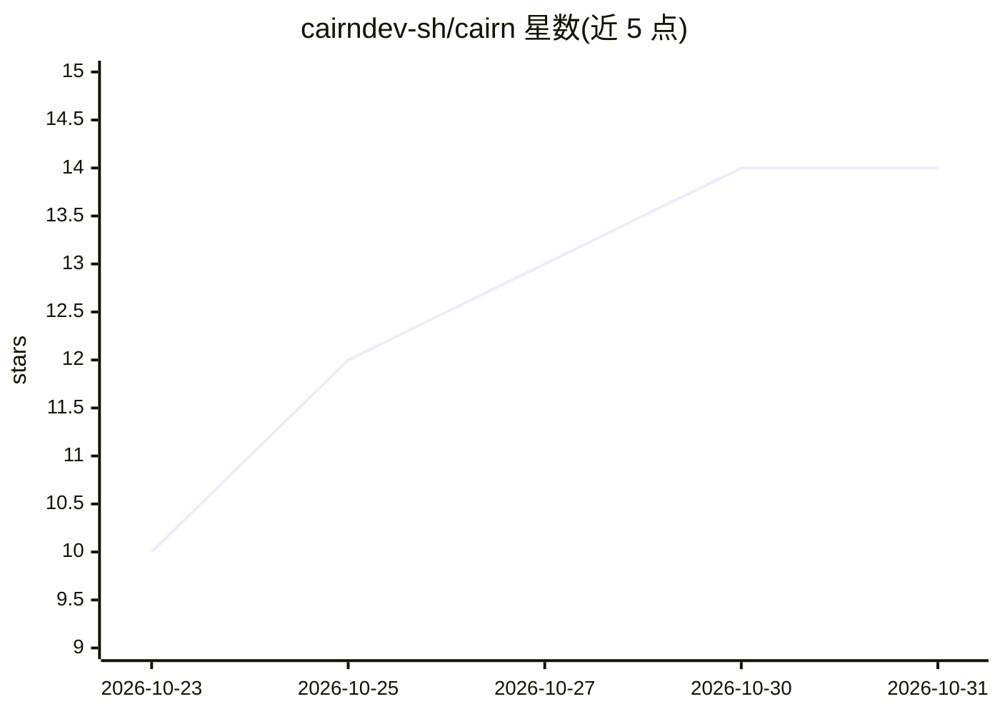

# cairndev-sh/cairn

⭐ 14 · Python · Apache-2.0 · 推送 2026-10-30 · [GitHub](https://github.com/cairndev-sh/cairn) · [官网](https://cairndev.sh/) · 组织维护

**自助托管的开源 ModelOps 控制平面：治理微调、评测、晋升与部署**

以"受治理命令"驱动 AI 工作流的控制平面：声明一个结果（数据集把关、微调、评测、晋升、部署），由引擎驱动底层工具并强制预算上限、策略门控与人审，全程写入哈希链审计日志。引擎域中立，领域知识放 pack、工具操作放 operator，单一机制复用于微调、数据检查、评测与事件响应。Apache-2.0 自托管，以 pip 安装的 `cairndev` 分发，含 CLI 与 HTTP+SSE API，提供 Docker/Helm 部署与在线演示。README 自述处于 early access，API 可能变动。

## 筛选速览

| 维度 | 判定 | 备注 |
|---|---|---|
| AI 角色 | `ai-ecosystem` | LLM/agent 周边工具 |
| 许可风险 | `permissive` | Apache-2.0 |
| 部署形态 | `self-host` | docker 或自建部署 |
| 模型依赖 | — | README 未给出锁定关系 |
| 硬件要求 | — | 无带数字的原话,不猜 |
| 安装摩擦 | `low` | 无编译、无系统依赖或容器化 |
| 成熟度 | `idea` | |

## 能力要点

- 硬预算上限：超限抛出 BudgetExceeded，运行不可静默超支
- 策略规则 + 人工审批门控，高风险操作暂停等人审并从检查点恢复
- 哈希链 append-only 审计日志记录每次模型调用、工具调用与审批
- 引用校验：模型引用的标识符与上下文精确匹配，未匹配的引用被剥离

## 适用场景

- 在自有基础设施上以预算和审批门控运行模型微调与评测流水线
- 为模型晋升、资源销毁等高风险操作加入人工审批与可回放记录
- 满足需要全程可审计的 ML 治理合规场景

## 场景标签

`工作流自动化` `模型评测` `微调` `MLOps` · 领域:效率与自动化

## 证据(README 行号)

> L6:  Fine-tune, evaluate, promote, and serve models as single governed commands —
> L25: cairn runs the work behind AI as **governed commands**. You declare an
> L27: promote it, serve it — and cairn drives the tools underneath, enforces the

## 星数曲线

2026-10-23 10 → 2026-10-31 14（+4）

---
*卡片 v1 · prompt 1.4 · 生成 2026-10-31 · 置信度 high · 依据 README sha `ea443afd4c3a` · [字段定义](../../DATASET.md)*
