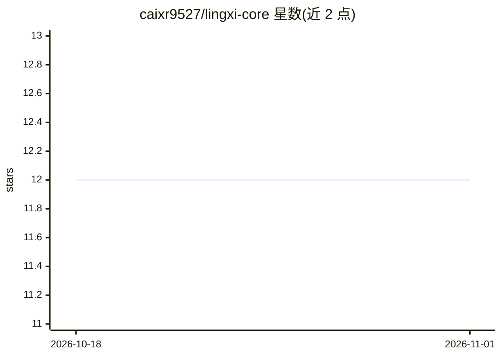

# caixr9527/lingxi-core

⭐ 12 · Python · Apache-2.0 · 推送 2025-11-26 · [GitHub](https://github.com/caixr9527/lingxi-core) · 个人维护 · 中文 README

**零代码构建 AI 应用与工作流并一键发布的开发平台**

面向无编程背景用户的 AI 应用开发平台：通过可视化界面创建问答机器人与工作流，支持自定义 AI 人设与提示词、Supervisor 协调的多 Agent 系统（Beta）、插件与知识库集成、MCP 客户端调用外部工具、版本回滚，并可一键发布到 Web 与微信公众号或通过 Open API（流式/非流式）集成。知识库基于 Weaviate 向量库提供相似度/全文/混合检索的 RAG。技术栈为 Vue3 + Python 3.12/Flask + LangChain/LangGraph + PostgreSQL + Redis + Celery。

## 筛选速览

| 维度 | 判定 | 备注 |
|---|---|---|
| AI 角色 | `ai-ecosystem` | LLM/agent 周边工具 |
| 许可风险 | `permissive` | Apache-2.0 |
| 部署形态 | `None` |  |
| 模型依赖 | — | README 未给出锁定关系 |
| 硬件要求 | — | 无带数字的原话,不猜 |
| 安装摩擦 | `low` | 无编译、无系统依赖或容器化 |
| 成熟度 | `idea` | |

## 能力要点

- 零代码可视化编排 AI 应用与多节点工作流（含 LLM 调用、意图识别、循环、代码执行等节点）
- 基于 Weaviate 的 RAG 知识库，支持相似度/全文/混合检索
- MCP 客户端配置调用外部工具与服务
- 一键发布至 Web/微信公众号，Open API 支持流式与非流式调用

## 适用场景

- 不写代码就搭建带知识库的问答机器人
- 通过可视化工作流编排复杂业务逻辑
- 将 Agent 应用发布到微信等渠道并接入现有系统

## 场景标签

`Agent 框架` `多智能体` `工作流自动化` `RAG` · 领域:Agent 开发

## 证据(README 行号)

> L9: **No coding required**—rapidly build various intelligent applications powered by advanced AI models, from simple Q&A
> L10: bots to complex logic-driven workflows. Upon completion, **publish with one click** to major social platforms, web

## 星数曲线

2026-10-18 12 → 2026-11-01 12（+0）

---
*卡片 v1 · prompt 1.4 · 生成 2026-11-01 · 置信度 mid · 依据 README sha `0a6a5cd352e5` · [字段定义](../../DATASET.md)*
