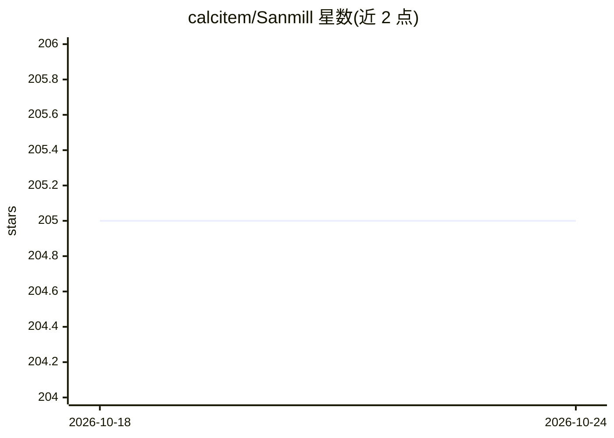

# calcitem/Sanmill

⭐ 205 · Dart · AGPL-3.0 · 推送 2026-10-23 · [GitHub](https://github.com/calcitem/Sanmill) · [官网](https://play.google.com/store/apps/details?id=com.calcitem.sanmill) · 个人维护 · 中文 README

**九子棋（直棋）开源游戏：Flutter GUI + Rust AI 引擎**

以 AGPL v3 分发的九子棋（Nine men's morris 及其变体）程序，提供 Flutter 图形界面与 Rust 编写的规则/搜索引擎（PVS、期望窗口、空着裁剪、MTD(f)、MCTS、迭代加深），并通过 flutter_rust_bridge 生成桥接代码，另附无头 Rust CLI。发行渠道覆盖 Google Play、F-Droid、App Store、Microsoft Store、Snap Store 与 CafeBazaar。可选的 AI 棋局分析为 18+ 默认关闭功能，官方发行版需满足一系列合规条件并在编译期开启。

## 筛选速览

| 维度 | 判定 | 备注 |
|---|---|---|
| AI 角色 | `ai-enhanced` | 去掉 AI 部分产品仍成立 |
| 许可风险 | `viral` | AGPL-3.0 |
| 部署形态 | `None` |  |
| 模型依赖 | local-ok | 支持本地模型 |
| 硬件要求 | — | 无带数字的原话,不猜 |
| 安装摩擦 | `low` | 无编译、无系统依赖或容器化 |
| 成熟度 | — | 结构信号不足 |

## 能力要点

- Rust 引擎实现 PVS/MTD(f)/MCTS/迭代加深等搜索算法
- Flutter 前端通过 flutter_rust_bridge 与 Rust 引擎桥接
- vendored C++ 完美残局库经 Rust perfect-db 封装
- 可选 AI 棋局分析支持本地 Ollama 或 HTTPS 代理，默认关闭且编译期强制门控

## 适用场景

- 在手机或桌面端与 AI 对弈九子棋
- 通过 Rust CLI 做无头引擎调试与测试
- 作为桌面棋类框架（TGF）的 Mill 实现参与贡献

## 场景标签

 · 领域:游戏/棋类软件

## 证据(README 行号)

> L35: Sanmill is a free, powerful N men's morris game with a Flutter GUI and a native Rust AI engine. It is distributed u
> L103: `crates/tgf-search`). The AI uses PVS with aspiration windows, null-move

## 星数曲线

2026-10-18 205 → 2026-10-24 205（+0）

---
*卡片 v1 · prompt 1.4 · 生成 2026-10-22 · 置信度 high · 依据 README sha `5eb94971cca5` · [字段定义](../../DATASET.md)*
