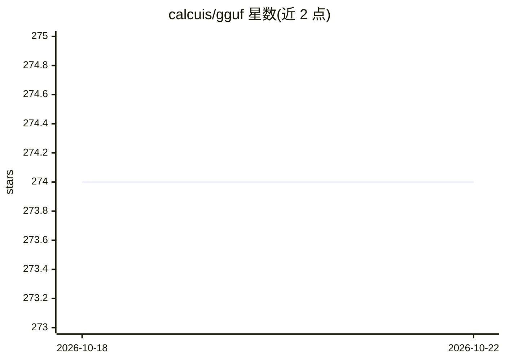

# calcuis/gguf

⭐ 274 · Python · MIT · 推送 2026-10-17 · [GitHub](https://github.com/calcuis/gguf) · [官网](https://pypi.org/project/gguf-node) · 个人维护

**ComfyUI 的 GGUF 节点：加载与转换 GGUF/ safetensors 模型**

面向 ComfyUI 用户的自定义节点包，通过 pip 安装后在 ComfyUI 中添加 gguf 菜单。提供 GGUF 模型/VAE/音频编码器加载器（同时支持 safetensors 格式），以及一组张量工具：TENSOR Booster（safetensors 升至 fp32）、TENSOR Cutter（bf16 切半至 fp8）、GGUF Convertor 及其 Zero 版本（safetensors 转 GGUF，支持扩散模型、VAE、编码器）与反向转换。README 声称无需额外依赖，可与 comfyui-gguf 节点共存，项目受其启发。

## 筛选速览

| 维度 | 判定 | 备注 |
|---|---|---|
| AI 角色 | `ai-ecosystem` | LLM/agent 周边工具 |
| 许可风险 | `permissive` | MIT |
| 部署形态 | `library` | 以包/库形式分发 |
| 模型依赖 | — | README 未给出锁定关系 |
| 硬件要求 | — | 无带数字的原话,不猜 |
| 安装摩擦 | `low` | 无编译、无系统依赖或容器化 |
| 成熟度 | — | 结构信号不足 |

## 能力要点

- GGUF 模型/VAE/音频编码器加载器，同时兼容 safetensors
- safetensors↔GGUF 双向转换（含无模型限制的 Convertor Zero）
- TENSOR Booster（升至 fp32）与 Cutter（bf16 切半至 fp8）工具
- 支持 s/k/t/i/mxfp4/nvfp4 等量化格式

## 适用场景

- 在 ComfyUI 中直接加载 GGUF 格式的扩散模型跑工作流
- 把已有的 safetensors 模型转成 GGUF 或做量化裁剪
- 用 Booster 修复 VAE 等需要 fp32 的张量黑屏问题

## 场景标签

`模型量化` · 领域:训练与推理

## 证据(README 行号)

> L28: *same operation for the standalone pack; then you should be able to see it under `Add Node >`*

## 星数曲线

2026-10-18 274 → 2026-10-22 274（+0）

---
*卡片 v1 · prompt 1.4 · 生成 2026-10-22 · 置信度 high · 依据 README sha `3be68419b2ef` · [字段定义](../../DATASET.md)*
