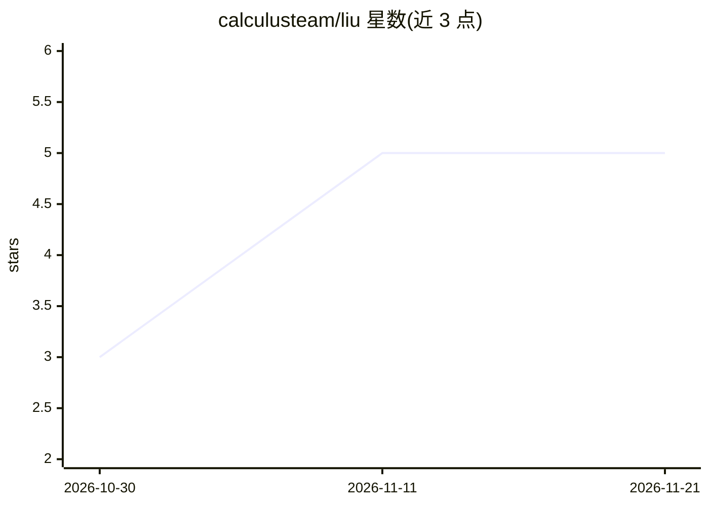

# calculusteam/liu

⭐ 5 · C · Apache-2.0 · 推送 2026-11-11 · [GitHub](https://github.com/calculusteam/liu) · [官网](https://liu.software) · 组织维护 · 中文 README

**给开发者的终端：统一浏览、恢复并排运行多个 AI 编码 agent**

C 语言编写的原生终端（macOS/Linux，GPU 加速），围绕 AI 编码 CLI 组织：命令面板可浏览已安装的各类 agent 并恢复会话；每个分屏 pane 中的 agent 状态（working/idle）被实时追踪，agent 之间可经 `liu-agent start` 互相委派任务，子 agent 自动生成 job 标签页。内置 Whisper large-v3-turbo 本地语音输入、Mermaid/Graphviz/PlantUML 图表渲染、Markdown 笔记库、代码编辑器、SSH 客户端与元素选择器浏览器。经 Releases 安装或从源码构建。

## 筛选速览

| 维度 | 判定 | 备注 |
|---|---|---|
| AI 角色 | `ai-ecosystem` | LLM/agent 周边工具 |
| 许可风险 | `permissive` | Apache-2.0 |
| 部署形态 | `desktop` | 安装包/桌面程序 |
| 模型依赖 | — | README 未给出锁定关系 |
| 硬件要求 | — | 无带数字的原话,不猜 |
| 安装摩擦 | `medium` | 含编译或系统依赖之一 |
| 成熟度 | — | 结构信号不足 |

## 能力要点

- 命令面板统一浏览与恢复 Claude Code、Codex、Copilot 等已装 agent 会话
- agent 可通过 liu-agent start 委派任务给其他 agent，子 agent 生成独立标签页
- Whisper large-v3-turbo 在本机离线转写语音输入，不经网络
- agent 输出的 Mermaid/Graphviz/PlantUML/LaTeX/SVG 渲染为可交互卡片

## 适用场景

- 在一个终端里并行管理多个 AI 编码 agent 的任务与会话
- 在无网络环境下用语音向 agent 输入 prompt
- 通过元素选择器把页面节点作为上下文发给 agent 修样式
- 用笔记 Vault 与 agent 共享同一份知识库

## 场景标签

`编码 Agent` `语音识别` · 领域:编码与开发

## 证据(README 行号)

> L5:  One terminal for every AI agent.
> L6:  Liu sits between you and a variety of coding agents and makes ten parallel threads feel like one place.
> L42: Press Cmd+K to open the command palette, then type "agent history" to browse every installed AI CLI: Claude Code, C

## 星数曲线

2026-10-30 3 → 2026-11-21 5（+2）

---
*卡片 v1 · prompt 1.4 · 生成 2026-11-21 · 置信度 high · 依据 README sha `0ec69d8d420a` · [字段定义](../../DATASET.md)*
