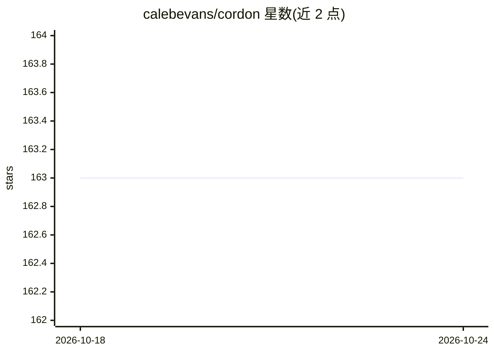

# calebevans/cordon

⭐ 163 · Python · Apache-2.0 · 推送 2026-07-20 · [GitHub](https://github.com/calebevans/cordon) · [官网](https://pypi.org/project/cordon/) · 个人维护

**用嵌入与密度评分从海量日志中提取语义异常段的工具**

面向运维/开发者的日志语义异常检测工具：将日志切分为行窗口，用 transformer 模型嵌入，计算 k-NN 余弦距离密度分数，选出最异常的窗口输出（XML/JSON）。重复模式（包括重复的严重错误）被视为正常背景并被过滤，输出设计为有损。后端支持 sentence-transformers（默认，CUDA/MPS 自动加速）、llama.cpp（容器 Vulkan）及经 LiteLLM 接入的远程嵌入 API（OpenAI、Gemini、Cohere 等）。提供 CLI、Python API、PyPI 安装与容器镜像，基准中 1M 行 HDFS 日志可压缩至 20K 行（98%）。

## 筛选速览

| 维度 | 判定 | 备注 |
|---|---|---|
| AI 角色 | `ai-native` | 本体是模型或模型工具 |
| 许可风险 | `permissive` | Apache-2.0 |
| 部署形态 | `library` | 以包/库形式分发 |
| 模型依赖 | local-ok | 支持本地模型 |
| 硬件要求 | — | 无带数字的原话,不猜 |
| 安装摩擦 | `medium` | 含编译或系统依赖之一 |
| 成熟度 | — | 结构信号不足 |

## 能力要点

- transformer 嵌入 + k-NN 密度评分的语义异常检测管线
- 三种嵌入后端：sentence-transformers（默认）/llama.cpp/远程 API（经 LiteLLM）
- --token-budget 按 tiktoken 裁剪输出以适配 LLM 上下文窗口
- percentile 与 range 两种过滤模式，可排除已知极端异常

## 适用场景

- 把超大日志压缩后再交给 LLM 分析
- 首次接手陌生日志时快速定位语义上不寻常的事件
- 排除启动噪声等已知问题，聚焦次一级异常模式

## 场景标签

 · 领域:DevOps/日志分析

## 证据(README 行号)

> L8: Cordon uses transformer embeddings and density scoring to identify semantically unusual patterns in large log files,
> L17: - **k-NN Density Scoring**: Identifies anomalies using k-NN distance in embedding space
> L19: - **Multiple Backends**: sentence-transformers (default), llama.cpp for containers, or remote APIs (OpenAI, Gemini,

## 星数曲线

2026-10-18 163 → 2026-10-24 163（+0）

---
*卡片 v1 · prompt 1.4 · 生成 2026-10-22 · 置信度 high · 依据 README sha `954b8064f849` · [字段定义](../../DATASET.md)*
