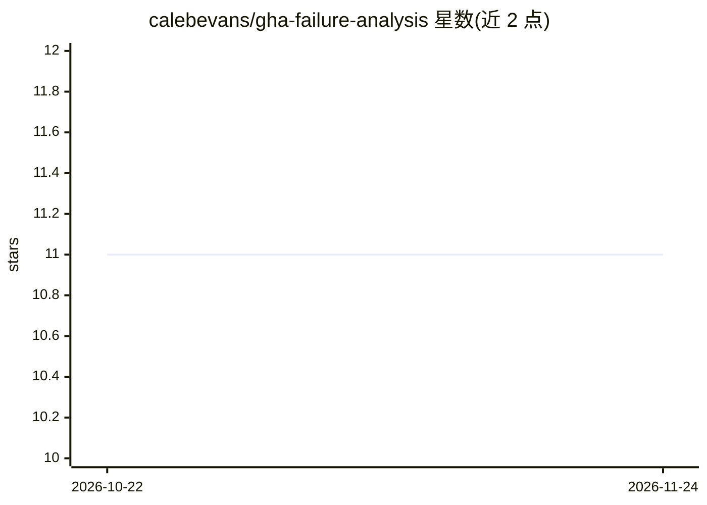

# calebevans/gha-failure-analysis

⭐ 11 · Python · Apache-2.0 · 推送 2026-07-20 · [GitHub](https://github.com/calebevans/gha-failure-analysis) · 个人维护

**GitHub Actions 失败日志的 AI 根因分析 Action**

以 GitHub Action 形式发布的 CI 失败分析工具：工作流失败时自动获取运行元数据与日志，先用 cordon 做基于嵌入的语义异常检测提取相关片段，再通过 DSPy/LiteLLM 调用所选 LLM 识别根因，并将 PR diff 与失败关联以判断改动是否为诱因，输出 job summary、PR 评论与 JSON 报告，输出前自动用 detect-secrets 脱敏。触发方式支持同工作流与 workflow_run 事件。LLM API key 为必需输入。

## 筛选速览

| 维度 | 判定 | 备注 |
|---|---|---|
| AI 角色 | `ai-native` | 本体是模型或模型工具 |
| 许可风险 | `permissive` | Apache-2.0 |
| 部署形态 | `None` |  |
| 模型依赖 | local-ok | 支持本地模型 |
| 硬件要求 | — | 无带数字的原话,不猜 |
| 安装摩擦 | `medium` | 含编译或系统依赖之一 |
| 成熟度 | — | 结构信号不足 |

## 能力要点

- cordon 语义日志预处理（remote/sentence-transformers 两种嵌入后端）
- 支持 DSPy/LiteLLM 兼容的多 LLM 提供商，含本地 Ollama
- PR diff 与失败的自动关联及影响评估
- 输出前使用 detect-secrets 自动脱敏

## 适用场景

- CI 工作流失败后自动生成根因分析报告
- 判断失败是否由本 PR 改动引起还是基础设施问题
- 在 PR 中以评论形式给出失败定位与建议

## 场景标签

`代码审查` · 领域:编码与开发

## 证据(README 行号)

> L8: When your GitHub Actions workflow fails, this action automatically analyzes logs, correlates failures with code chan
> L13: - **LLM-Powered Analysis**: Leverages DSPy and your choice of LLM (OpenAI, Anthropic, Gemini, Ollama) for intellige

## 星数曲线

2026-10-22 11 → 2026-11-24 11（+0）

---
*卡片 v1 · prompt 1.4 · 生成 2026-11-18 · 置信度 high · 依据 README sha `e93c5fb9e157` · [字段定义](../../DATASET.md)*
