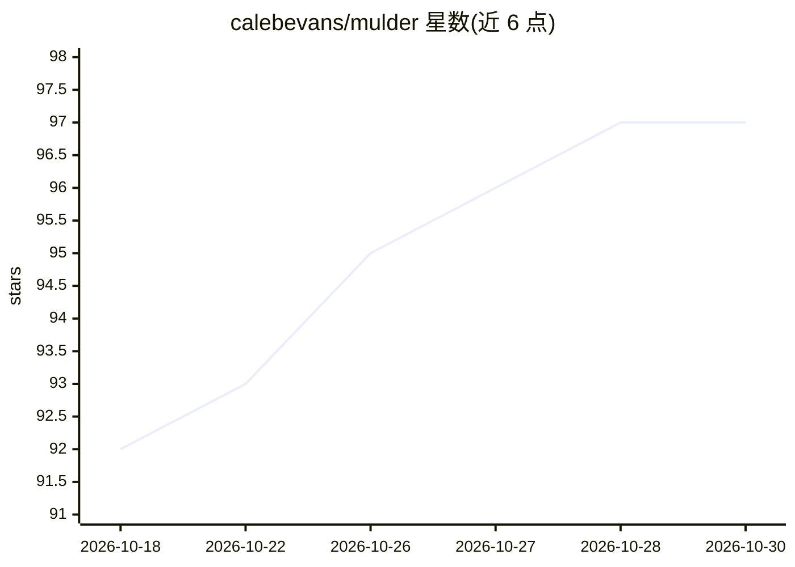

# calebevans/mulder

⭐ 97 · Python · Apache-2.0 · 推送 2026-10-28 · [GitHub](https://github.com/calebevans/mulder) · 个人维护

**自主数字取证调查 agent：对取证证据自动产出事件报告**

面向 DFIR/事件响应人员的自主调查工具：输入含磁盘镜像、内存转储、PCAP、事件日志的证据目录，经五阶段（编目、提取、跨系统分析、对抗性替代叙事、报告）流水线运行，阶段间设质量门禁；产出带 MITRE ATT&CK 映射的事件报告、IOC 导出与审计日志。关键机制：全部 140+ 工具调用走类型化 MCP 接口、禁用 shell 与网络，提交时在 API 边界校验证据引用以防捏造；三个流水线角色可分配给不同模型以控制成本。README 给出 Claude Opus、Kimi、GLM 等模型在 NIST CFReDS 数据集上的多次运行评分卡。以 pipx/uv 安装或 Docker 镜像运行，需 SIFT 或自行安装取证工具链。

## 筛选速览

| 维度 | 判定 | 备注 |
|---|---|---|
| AI 角色 | `ai-native` | 本体是模型或模型工具 |
| 许可风险 | `permissive` | Apache-2.0 |
| 部署形态 | `self-host` | docker 或自建部署 |
| 模型依赖 | — | README 未给出锁定关系 |
| 硬件要求 | — | 无带数字的原话,不猜 |
| 安装摩擦 | `low` | 无编译、无系统依赖或容器化 |
| 成熟度 | — | 结构信号不足 |

## 能力要点

- 五阶段自主调查流水线，阶段间质量门禁与有界重试
- 140+ 工具调用全部走类型化 MCP 接口，禁用 shell 与 Claude Code 内置工具
- 提交时校验 evidence_refs 指向追加式审计日志中的真实 tool_call_id，结构性阻止捏造引用
- 整合 35+ 开源取证工具（Volatility 3、Sleuth Kit、Zeek、YARA 等）

## 适用场景

- 对磁盘镜像/内存转储/网络抓包做自动化事件调查并生成报告
- 输出带 MITRE ATT&CK 映射与 IOC 导出（STIX 2.1/CSV）的结构化取证结论
- 用对抗性自查阶段挑战初步结论，降低误报与叙事偏差

## 场景标签

`网络安全` · 领域:学习与行业

## 证据(README 行号)

> L4: Mulder takes a directory of forensic evidence (disk images, memory dumps, PCAPs, event logs) and runs a five-phase a
> L30: Each investigation runs through five phases with quality gates between them. Phases 2-4 use a plan-and-execute pipe
> L42: **No shell access, no built-in tools.** All 140+ tool invocations go through typed MCP interfaces with validated pa

## 星数曲线

2026-10-18 92 → 2026-10-30 97（+5）

---
*卡片 v1 · prompt 1.4 · 生成 2026-10-24 · 置信度 high · 依据 README sha `b912df12f6d3` · [字段定义](../../DATASET.md)*
