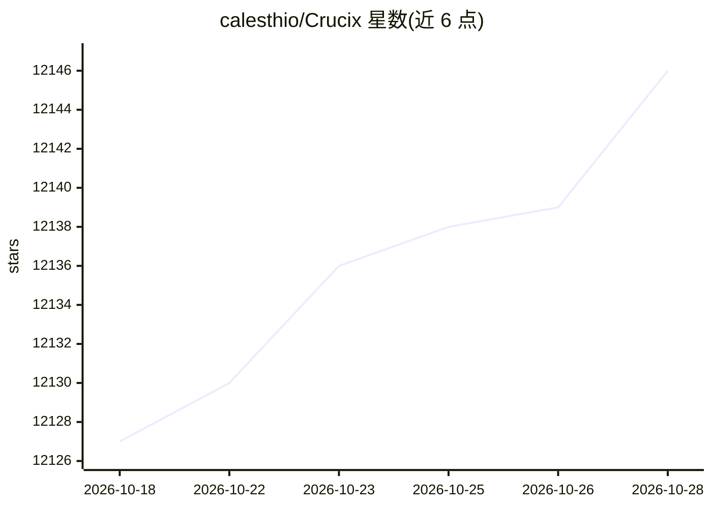

# calesthio/Crucix

⭐ 12,146 · JavaScript · AGPL-3.0 · 推送 2026-05-20 · [GitHub](https://github.com/calesthio/Crucix) · [官网](https://crucix.live) · 个人维护

**本地自托管的 OSINT 情报聚合终端：27 个公开数据源一张仪表盘**

自托管的个人情报终端：每 15 分钟并行抓取 27 个公开情报源（卫星火灾、航班、辐射、冲突、制裁、经济指标、行情、社媒情绪等），交叉关联后渲染到带 3D 地球的 Jarvis 风格仪表盘，并通过 SSE 推送增量变化。支持 Telegram/Discord 双向机器人命令与多级告警。LLM 为可选层：接入 8 家提供商可生成交易观点与智能分级告警，未配置时回退到规则引擎。面向研究者、记者、交易员与 OSINT 分析者，本地运行 Node.js 22+ 或 Docker，AGPL v3。

## 筛选速览

| 维度 | 判定 | 备注 |
|---|---|---|
| AI 角色 | `ai-enhanced` | 去掉 AI 部分产品仍成立 |
| 许可风险 | `viral` | AGPL-3.0 |
| 部署形态 | `desktop` | 安装包/桌面程序 |
| 模型依赖 | locked-api |  |
| 硬件要求 | — | 无带数字的原话,不猜 |
| 安装摩擦 | `low` | 无编译、无系统依赖或容器化 |
| 成熟度 | — | 结构信号不足 |

## 能力要点

- 27 个公开情报源并行抓取，每 15 分钟自动刷新
- 3D WebGL 地球与平面地图两种视图，9 类标记
- Telegram/Discord 双向机器人（/brief、/sweep 等命令）与 FLASH/PRIORITY/ROUTINE 多级告警
- 可选接入 8 家 LLM 提供商，未配置时回退规则引擎

## 适用场景

- 在一块仪表盘上跟踪全球实时事件与市场数据
- 通过手机 Telegram/Discord 接收情报简报与突发告警
- 本地零云端聚合开源情报数据做研究分析

## 场景标签

`网页抓取` `科研工具` · 领域:效率与自动化

## 证据(README 行号)

> L36: Crucix pulls satellite fire detection, flight tracking, radiation monitoring, satellite constellation tracking, eco
> L38: Hook it up to an LLM and it becomes a **two-way intelligence assistant** — pushing multi-tier alerts to Telegram an
> L167: ### Optional LLM Layer

## 星数曲线

2026-10-18 12,127 → 2026-10-28 12,146（+19）

---
*卡片 v1 · prompt 1.4 · 生成 2026-10-20 · 置信度 mid · 依据 README sha `701a81d9ff48` · [字段定义](../../DATASET.md)*
