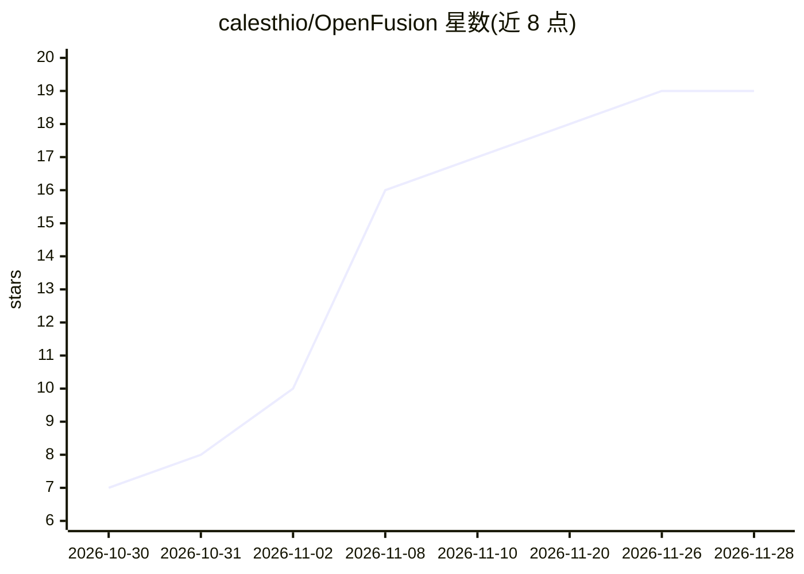

# calesthio/OpenFusion

⭐ 19 · Python · MIT · 推送 2026-10-29 · [GitHub](https://github.com/calesthio/OpenFusion) · 个人维护

**给 AI 编程 agent 的多模型路由：子任务派给够用的低价模型**

面向 Claude Code、Codex、Cursor、GitHub Copilot、Gemini CLI、Antigravity、OpenCode 等编程 agent 的路由技能：把每个子任务按 fast/standard/deep 三档派发到对应模型，支持 single、cascade（草稿→judge→升级）、critique（草稿→并行评审→修订）三种模式；测试失败、工具循环或 revise 判定会自动升级模型档位。本体是纯 Python 3.9+ 的路由器，零运行时依赖，不自行调用模型、不需要 API key，通过配置各 harness 自带的 subagent 完成，同一代码在 macOS/Linux/Windows 输出一致。

## 筛选速览

| 维度 | 判定 | 备注 |
|---|---|---|
| AI 角色 | `ai-ecosystem` | LLM/agent 周边工具 |
| 许可风险 | `permissive` | MIT |
| 部署形态 | `desktop` | 安装包/桌面程序 |
| 模型依赖 | — | README 未给出锁定关系 |
| 硬件要求 | — | 无带数字的原话,不猜 |
| 安装摩擦 | `low` | 无编译、无系统依赖或容器化 |
| 成熟度 | — | 结构信号不足 |

## 能力要点

- fast/standard/deep 三档模型路由，single/cascade/critique 三种执行模式
- judge 评审与自动升级机制（测试失败/工具循环/低置信度升档）
- 零运行时依赖的纯 Python 路由器，不自持 API key，复用 agent 已有的 subagent
- 通过 openfusion.yaml 集中配置层级、路由规则与各工具模型映射，可插接 LLM 分类器并回退规则

## 适用场景

- 让编程 agent 把查找、文档总结等子任务交给低价模型以控制成本
- 在 Claude Code / Codex / Cursor 等多个工具间共用同一套路由配置
- 通过 judge 评审与自动升级保证低档模型产出的质量

## 场景标签

`模型网关` · 领域:Agent 开发

## 证据(README 行号)

> L17: OpenFusion routes **each subtask to the cheapest model that can do it well**, and has a **judge escalate to
> L21: - **One skill, every harness.** Claude Code, Codex, GitHub Copilot, Cursor, Gemini CLI, Google Antigravity,
> L29:  keys, no proxy. Your agent's own subagents do the work on the models you already pay for.

## 星数曲线

2026-10-30 7 → 2026-11-28 19（+12）

---
*卡片 v1 · prompt 1.4 · 生成 2026-11-18 · 置信度 high · 依据 README sha `90f781383be6` · [字段定义](../../DATASET.md)*
