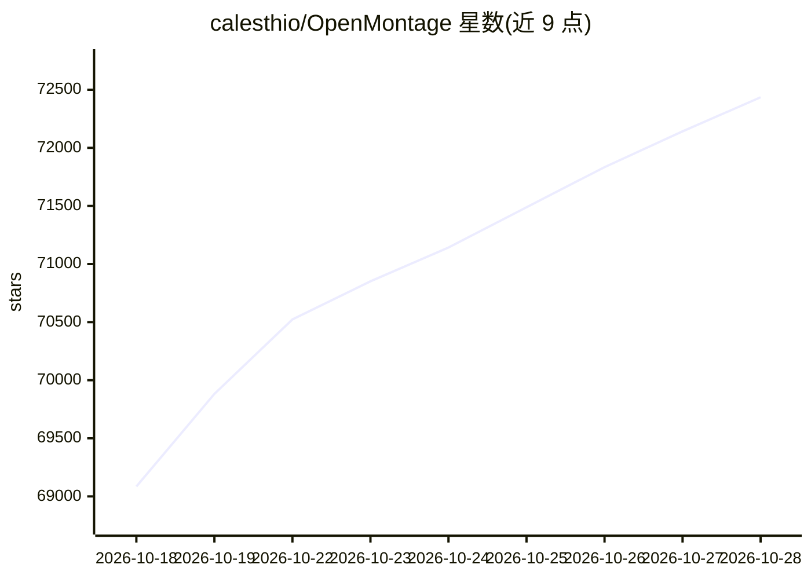

# calesthio/OpenMontage

⭐ 72,435 · Python · AGPL-3.0 · 推送 2026-10-24 · [GitHub](https://github.com/calesthio/OpenMontage) · [官网](https://www.openmontage.video/) · 组织维护

**把 AI 编码助手变成完整视频制作工作室的 agentic 系统**

OpenMontage 是一套以 agent 驱动的视频生产系统：12 条制作流水线、100+ 工具、700+ agent 技能与制作知识文件，用户用自然语言描述需求，由 AI 编码助手（Claude Code/Cursor/Copilot/Windsurf/Codex）完成调研、脚本、素材生成、剪辑与合成。支持图片式视频与真实素材路径（从 Archive.org、NASA 等开放档案检索动态片段后剪辑渲染）。依赖 Python 3.10+、FFmpeg、Node.js 18+，通过 make setup 或手动 venv/npm 安装；所有 API key 可选，零 key 时用 Piper TTS 等免费工具。含 Backlot 本地看板用于实时展示制作进度与人工审批门。

## 筛选速览

| 维度 | 判定 | 备注 |
|---|---|---|
| AI 角色 | `ai-native` | 本体是模型或模型工具 |
| 许可风险 | `viral` | AGPL-3.0 |
| 部署形态 | `library` | 以包/库形式分发 |
| 模型依赖 | local-ok | 支持本地模型 |
| 硬件要求 | — | 无带数字的原话,不猜 |
| 安装摩擦 | `high` | 编译与系统依赖俱全 |
| 成熟度 | — | 结构信号不足 |

## 动量与使用信号

- 维护:`active` — 距上次 push 1.7 天,年发版 0,67 位贡献者
- 涨星:近 1 天 **+363**(自 20261016 起算)
- 安装:npm 包 `hyperframes` 月下载 2,651,881
- 平台:— · 协议:OLLAMA

## 能力要点

- 12 条制作流水线、100+ 工具、700+ agent 技能与制作知识文件
- 从 YouTube/Shorts/TikTok/本地片段出发生成有依据的制作方案与成本预估
- Backlot 本地看板：分阶段展示进度、分镜审批门与可审计的 provider 决策日志
- 零 API key 路径：Piper TTS 旁白、开放档案素材、Remotion/HyperFrames 合成、FFmpeg 后期

## 适用场景

- 用自然语言让编码助手生成动画短片、纪录片或产品宣传视频
- 从参考视频出发生成风格相近的新主题视频方案
- GPU 本地离线生成视频片段，避免按次付费 API

## 场景标签

`视频生成` `图像生成` `语音合成` · 领域:内容生成

## 证据(README 行号)

> L34: Turn your AI coding assistant into a full video production studio. Describe what you want in plain language — your 
> L93: Works with **Claude Code, Cursor, Copilot, Windsurf, Codex** — any AI coding assistant that can read files and run 
> L167:  OpenMontage is pipeline-driven. Real work goes through `pipeline_defs/`, stage director skills in `skills/pipelin

## 星数曲线

2026-10-18 69,085 → 2026-10-28 72,435（+3,350）

---
*卡片 v1 · prompt 1.4 · 生成 2026-10-18 · 置信度 high · 依据 README sha `9727b6758338` · [字段定义](../../DATASET.md)*
