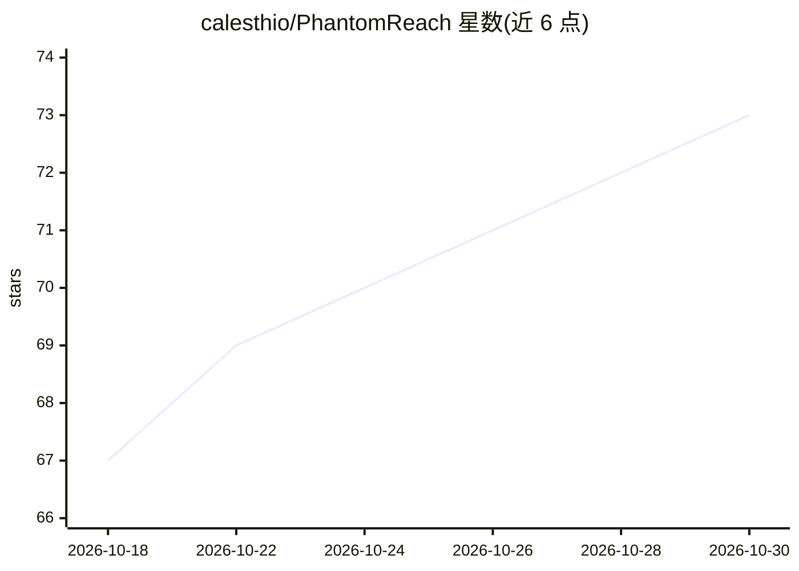

# calesthio/PhantomReach

⭐ 73 · TypeScript · AGPL-3.0 · 推送 2026-06-27 · [GitHub](https://github.com/calesthio/PhantomReach) · [官网](https://github.com/calesthio/PhantomReach) · 个人维护

**给营销人员的本地商家情报审计工具，AI 生成顾问式报告**

基于 Next.js 15 + TypeScript 的本地运行应用：输入商家名称后采集 Google Business Profile、评论、竞品、PageSpeed、社交与技术栈等公开数据，存入本地 SQLite，可选接入 OpenAI/Anthropic/Google AI 的模型生成执行摘要、因果分析与建议，并导出 PDF/DOCX/PPTX/XLSX 报告。缺 API key 的模块标记为不可用而非伪造数据；无 AI key 时数据报告仍可运行。附带 AGENTS.md，可由 AI 编程助手通过 API 端点驱动审计全流程。面向营销人员与代理机构。

## 筛选速览

| 维度 | 判定 | 备注 |
|---|---|---|
| AI 角色 | `ai-enhanced` | 去掉 AI 部分产品仍成立 |
| 许可风险 | `viral` | AGPL-3.0 |
| 部署形态 | `library` | 以包/库形式分发 |
| 模型依赖 | — | README 未给出锁定关系 |
| 硬件要求 | — | 无带数字的原话,不猜 |
| 安装摩擦 | `low` | 无编译、无系统依赖或容器化 |
| 成熟度 | — | 结构信号不足 |

## 能力要点

- 多模块本地审计：Google 资料、评论、竞品、PageSpeed、社交、技术栈
- 可选接入 OpenAI/Anthropic/Google AI 生成顾问式分析叙述
- PDF/DOCX/PPTX/XLSX 四种格式导出
- 提供 /api/audit 等 API 端点与 AGENTS.md 剧本，可由编程助手驱动

## 适用场景

- 为本地商家快速生成数字化表现审计报告
- 代理机构批量产出可直接交付客户的 PDF/PPT 分析
- 让 AI 编程助手自动运行审计并撰写后续研究材料

## 场景标签

`数据分析` · 领域:效率与自动化

## 证据(README 行号)

> L99: > No AI key? The audit still runs and renders the full data-driven report — the narrative layer simply stays off. Y
> L41: - **AI executive analysis** — bring your own OpenAI, Anthropic, or Google AI key and a frontier model synthesizes t

## 星数曲线

2026-10-18 67 → 2026-10-30 73（+6）

---
*卡片 v1 · prompt 1.4 · 生成 2026-10-24 · 置信度 high · 依据 README sha `e5b92501ef9b` · [字段定义](../../DATASET.md)*
