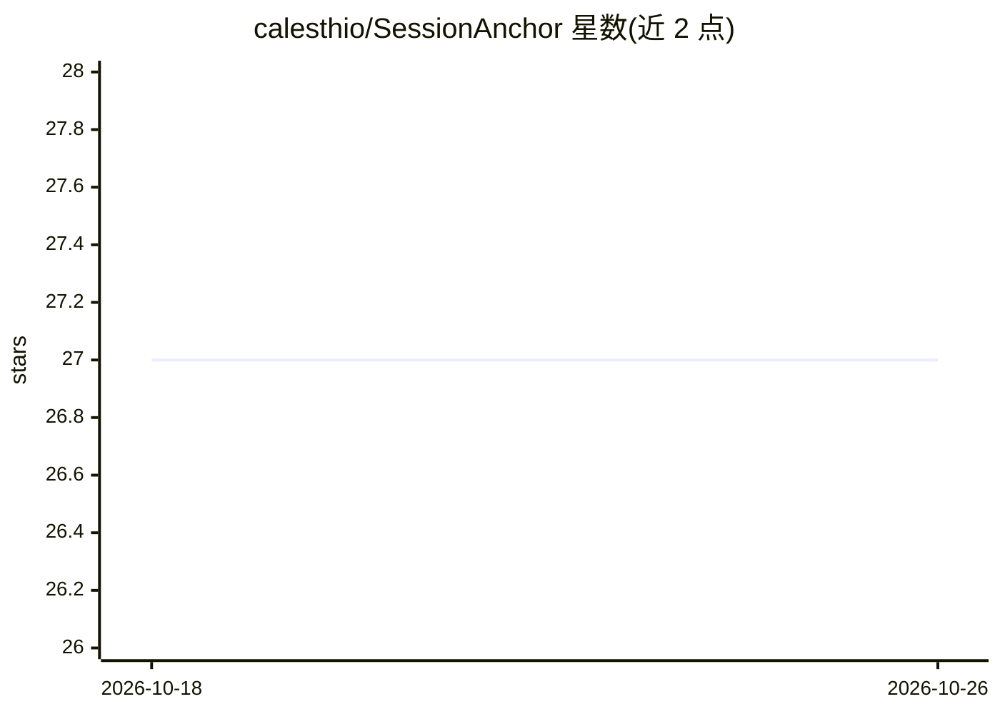

# calesthio/SessionAnchor

⭐ 27 · Python · AGPL-3.0 · 推送 2026-03-25 · [GitHub](https://github.com/calesthio/SessionAnchor) · [官网](https://pypi.org/project/SessionAnchor/) · 个人维护

**给 Claude Code 会话提供本地 SQLite 跨会话记忆的 CLI 工具**

面向 Claude Code 用户的上下文记忆工具：以单个 SQLite 数据库（存于 .claude/memory/context.db）替代平铺的 markdown 上下文文件，采用三层记忆模型（L0/L1 启动加载约 2000 token，L2 按需查询），启动时生成结构化简报，并以 FTS5+BM25 做关键词检索、时间/数量规则做自动降级压实。零依赖、纯本地，无需服务器或 API key，通过修改 CLAUDE.md 指示 Claude 持续保存记忆。明确不做语义检索、多云同步与自动摘要。

## 筛选速览

| 维度 | 判定 | 备注 |
|---|---|---|
| AI 角色 | `ai-ecosystem` | LLM/agent 周边工具 |
| 许可风险 | `viral` | AGPL-3.0 |
| 部署形态 | `library` | 以包/库形式分发 |
| 模型依赖 | — | README 未给出锁定关系 |
| 硬件要求 | — | 无带数字的原话,不猜 |
| 安装摩擦 | `low` | 无编译、无系统依赖或容器化 |
| 成熟度 | — | 结构信号不足 |

## 能力要点

- 三层记忆模型，启动仅加载约 2000 token（L0+L1），L2 按查询检索
- 单一 SQLite 文件存储，WAL 并发与 FTS5 全文检索，零外部依赖
- 自动压实（14 天/20 条/3 天完成宽限/supersedes 归档）保持 L1 有界
- 密钥过滤：.contextignore 与 AWS key/API token/JWT/Bearer 模式自动脱敏

## 适用场景

- 让 Claude Code 在新会话中恢复上次决策、进度与阻塞项
- 减少每次会话启动时读取大量 markdown 上下文的 token 消耗
- 单开发者单仓库的个人记忆管理，全程本地不依赖云服务

## 场景标签

`Agent 记忆` · 领域:Agent 开发

## 证据(README 行号)

> L7: One-command context memory for Claude Code sessions.
> L22: `SessionAnchor` replaces flat context files with a local SQLite memory store that uses tiered retrieval. One comman
> L40: It is **not** a general-purpose memory layer, a hosted service, or a multi-agent coordination framework. It solves 

## 星数曲线

2026-10-18 27 → 2026-10-26 27（+0）

---
*卡片 v1 · prompt 1.4 · 生成 2026-10-26 · 置信度 high · 依据 README sha `b35805a95b1e` · [字段定义](../../DATASET.md)*
