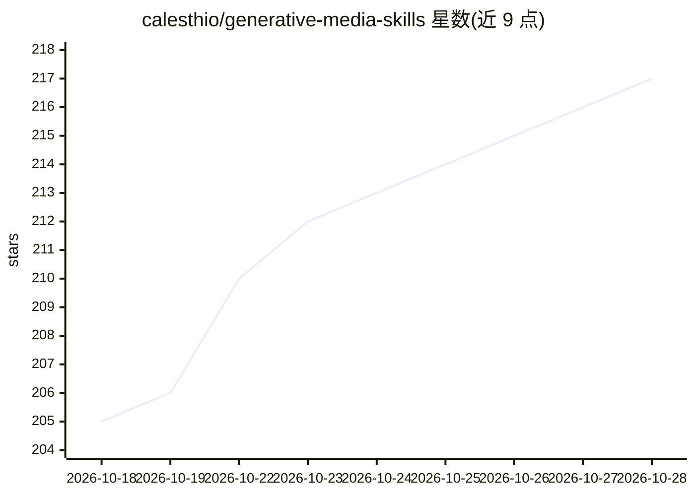

# calesthio/generative-media-skills

⭐ 217 · Python · MIT · 推送 2026-07-14 · [GitHub](https://github.com/calesthio/generative-media-skills) · [官网](https://github.com/calesthio/OpenMontage) · 个人维护

**面向 AI 编码助手的生成式媒体制作技能库（153 个技能包）**

为可加载 Agent Skills 的运行时（Claude Code、Codex、GitHub Copilot、Cursor、OpenClaw/Hermes 类 agent）提供的技能仓库：收录 153 个技能包，覆盖图像、视频、音频、语音、音乐、3D、数字人视频等 25 个类别，分为 Providers（模型/供应商选型知识）与 Production（导演、后期、治理交付）两族。每个技能含 SKILL.md 入口与仓库内隐藏的 EVAL.md 评测；部分技能附带 scripts/references/assets。使用方式是将 agent 指向仓库并按需加载技能。

## 筛选速览

| 维度 | 判定 | 备注 |
|---|---|---|
| AI 角色 | `ai-knowledge` | 知识聚合/清单类 |
| 许可风险 | `permissive` | MIT |
| 部署形态 | `None` |  |
| 模型依赖 | — | README 未给出锁定关系 |
| 硬件要求 | — | 无带数字的原话,不猜 |
| 安装摩擦 | `low` | 无编译、无系统依赖或容器化 |
| 成熟度 | — | 结构信号不足 |

## 能力要点

- 153 个技能包，覆盖 25 个类别（Providers 与 Production 两族）
- 每个技能含隐藏 EVAL.md 评测与渐进式加载结构
- 技能为纯 Markdown 加可移植资源，不绑定专有运行时
- 配套 AGENTS.md 及多种 agent 入口文件（CLAUDE.md/copilot-instructions 等）

## 适用场景

- 让 AI 编码助手从创意简报产出带 QA 与版权说明的媒体交付物
- 为媒体生成任务选择合适的模型、API 与本地运行时
- 媒体制作流程中执行确定性校验（响度、字幕、ComfyUI 图等）

## 场景标签

`图像生成` `视频生成` `语音合成` · 领域:内容生成

## 证据(README 行号)

> L5: **150+ research-backed skills across 25 categories** for creating, directing, validating, and delivering image, vide
> L47: Browse all 153 packages in SKILL_INDEX.md.

## 星数曲线

2026-10-18 205 → 2026-10-28 217（+12）

---
*卡片 v1 · prompt 1.4 · 生成 2026-10-22 · 置信度 high · 依据 README sha `d444f07ad316` · [字段定义](../../DATASET.md)*
