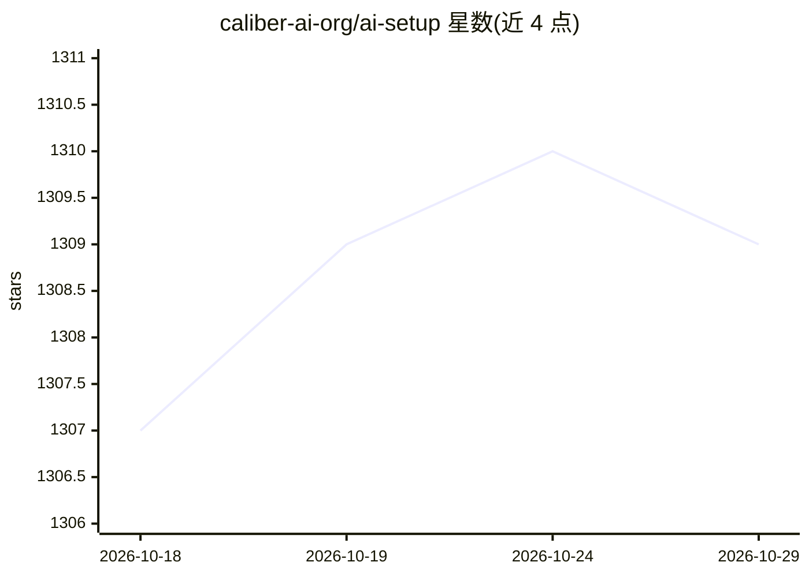

# caliber-ai-org/ai-setup

⭐ 1,309 · TypeScript · MIT · 推送 2026-09-24 · [GitHub](https://github.com/caliber-ai-org/ai-setup) · [官网](https://trycaliber.ai) · 组织维护

**为多款编码 agent 统一生成与同步技能、规则和配置的 CLI 工具**

面向开发者的命令行工具：通过 `npx @rely-ai/caliber bootstrap` 初始化，为 Claude Code、Cursor、Codex、OpenCode、GitHub Copilot 生成 CLAUDE.md、Cursor rules、AGENTS.md、Copilot instructions 等配置文件，并以 pre-commit hook 读取 diff 刷新上下文。`caliber score` 无 LLM 校验配置与仓库是否漂移；`caliber sync` 在各 agent 间镜像技能、规则、插件与 MCP；另有 Jev 压缩插件（评分工具调用、保留消息原文）。每次写入先展示 diff 并备份。需 Node 20+，评分与同步全本地运行。

## 筛选速览

| 维度 | 判定 | 备注 |
|---|---|---|
| AI 角色 | `ai-ecosystem` | LLM/agent 周边工具 |
| 许可风险 | `permissive` | MIT |
| 部署形态 | `library` | 以包/库形式分发 |
| 模型依赖 | — | README 未给出锁定关系 |
| 硬件要求 | — | 无带数字的原话,不猜 |
| 安装摩擦 | `low` | 无编译、无系统依赖或容器化 |
| 成熟度 | — | 结构信号不足 |

## 能力要点

- 一份技能/规则同步到多个编码 agent（技能可降级为 Copilot 指令文件）
- 无 LLM 的 `caliber score` 校验配置文件路径与命令真实性
- Jev 压缩：按工具调用评分替换 Claude Code 的 /compact，保留消息原文
- 所有写入先展示 diff 并备份到 .caliber/backups/

## 适用场景

- 多 agent 环境下维护一份共享的技能和规则
- 提交前自动刷新 agent 读取的上下文配置
- 审计 CLAUDE.md 等配置是否与代码库漂移

## 场景标签

`提示工程` · 领域:Agent 开发

## 证据(README 行号)

> L3:  The open-source context layer for coding agents.
> L18: Then, in Claude Code or the Cursor CLI, run `/setup-caliber`. Your agent writes `CLAUDE.md`, Cursor rules, `AGENTS.
> L69: |`caliber sync`|Mirror skills, rules, plugins and MCP across agents|

## 星数曲线

2026-10-18 1,307 → 2026-10-29 1,309（+2）

---
*卡片 v1 · prompt 1.4 · 生成 2026-10-21 · 置信度 high · 依据 README sha `e9912d5f5732` · [字段定义](../../DATASET.md)*
