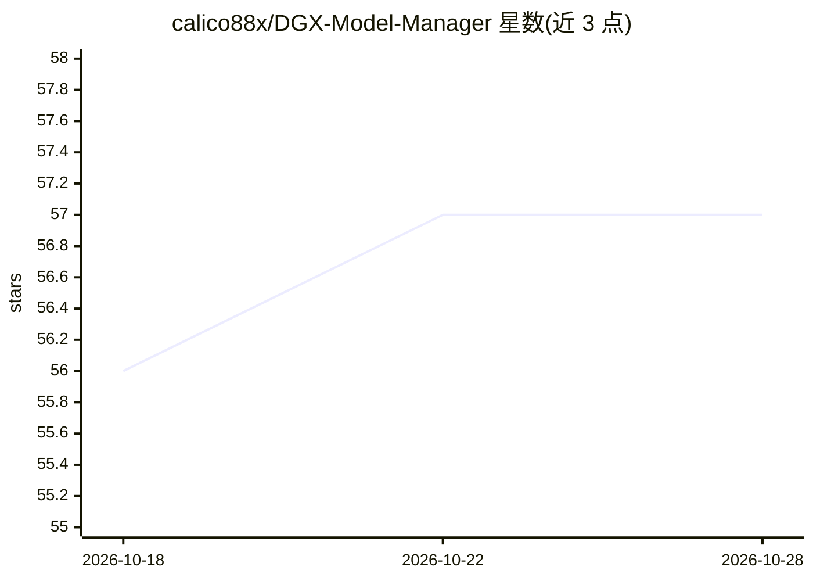

# calico88x/DGX-Model-Manager

⭐ 57 · Python · MIT · 推送 2026-10-18 · [GitHub](https://github.com/calico88x/DGX-Model-Manager) · 个人维护

**面向 DGX Spark 的模型与推理部署管理 Web 控制台**

浏览器端控制平面，面向 NVIDIA DGX Spark / GB10 主机：扫描 Hugging Face 本地缓存生成模型清单（含量化与参数量元数据），对接已有 Ollama 服务做模型发现与下载，管理 LiteLLM 路由；Compose Builder 将模型元数据与目标节点容量转换为部署计划，为 vLLM、SGLang、llama.cpp 等生成 Docker Compose 文件并提供保存/启停/归档生命周期管理。含多用户角色、API 令牌、审计日志与多节点管理。自身不代理推理流量；通过 setup.sh 源码安装，需 Docker、NVIDIA Container Toolkit 与 systemd。

## 筛选速览

| 维度 | 判定 | 备注 |
|---|---|---|
| AI 角色 | `ai-ecosystem` | LLM/agent 周边工具 |
| 许可风险 | `permissive` | MIT |
| 部署形态 | `self-host` | docker 或自建部署 |
| 模型依赖 | local-ok | 支持本地模型 |
| 硬件要求 | — | 无带数字的原话,不猜 |
| 安装摩擦 | `low` | 无编译、无系统依赖或容器化 |
| 成熟度 | — | 结构信号不足 |

## 能力要点

- 扫描 Hugging Face 缓存生成含量化与参数量元数据的模型清单
- Compose Builder 按模型与节点容量生成 vLLM/SGLang/llama.cpp 等部署计划
- Ollama / LiteLLM 集成：模型下载、路由发现与配置展示
- 三角色权限、作用域 API 令牌、审计日志与多节点管理

## 适用场景

- 在 DGX Spark 上盘点本地模型并为多推理引擎生成 Compose 部署
- 通过 Web 界面管理 Ollama 模型下载与 LiteLLM 路由
- 团队多人分角色管理模型服务基础设施并留存审计记录

## 场景标签

`推理引擎` · 领域:训练与推理

## 证据(README 行号)

> L3: DGX Model Manager v2 is a secure, Compose-first control plane for NVIDIA DGX Spark model operations.
> L10: - DGX-aware Compose generation
> L18: The manager controls model-serving infrastructure. It does **not** proxy inference traffic itself.

## 星数曲线

2026-10-18 56 → 2026-10-28 57（+1）

---
*卡片 v1 · prompt 1.4 · 生成 2026-10-24 · 置信度 mid · 依据 README sha `1c97de715a8b` · [字段定义](../../DATASET.md)*
