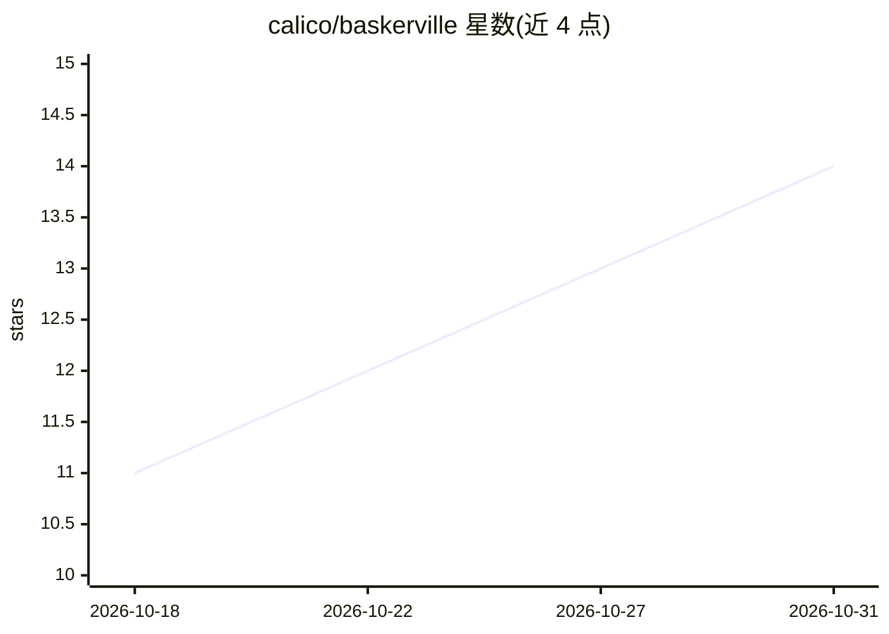

# calico/baskerville

⭐ 14 · Python · Apache-2.0 · 推送 2026-10-24 · [GitHub](https://github.com/calico/baskerville) · 组织维护

**从 DNA 序列预测基因调控活性的预训练深度学习模型库**

Calico 维护的 PyTorch 模型工具库，提供 Cerberus 及其前身 Borzoi、Borzoi Prime 的预训练权重与训练/归因/评测脚本。模型读取 DNA 序列，预测染色质可及性、基因表达等功能基因组学 track。Cerberus 用双向状态空间（Hydra）模块替换 Borzoi 的 transformer，读取 786 kb 序列，在 32 bp 分辨率下预测人 8,361 条与鼠 3,102 条 track。Cerberus 需 NVIDIA GPU，Borzoi 系列可 CPU 运行；基因与 SNP 打分需 PATH 中的 bedtools。支持本地、GCP Batch、Slurm 后端（Slurm 依赖不公开）。

## 筛选速览

| 维度 | 判定 | 备注 |
|---|---|---|
| AI 角色 | `ai-native` | 本体是模型或模型工具 |
| 许可风险 | `permissive` | Apache-2.0 |
| 部署形态 | `desktop` | 安装包/桌面程序 |
| 模型依赖 | — | README 未给出锁定关系 |
| 硬件要求 | `cpu-ok` | |
| 安装摩擦 | `low` | 无编译、无系统依赖或容器化 |
| 成熟度 | — | 结构信号不足 |

## 能力要点

- Cerberus 以双向状态空间（Hydra）模块预测 8,361 人/3,102 鼠功能基因组学 track
- 提供 786 kb 序列输入、32 bp 分辨率输出，涵盖 RNA-seq/CAGE/DNase/ATAC/ChIP/CLIP 等
- 含训练、迁移学习、蒸馏、ISM、SNP 分析与梯度归因脚本
- 预训练权重托管于公开 GCS 桶，经 releases/ 分发

## 适用场景

- 从 DNA 序列预测基因调控活性用于基因组学研究
- 对 SNP 做计算诱变与打分分析
- 在自有数据上做迁移学习或蒸馏训练序列模型

## 场景标签

`科研工具` · 领域:学习与行业

## 证据(README 行号)

> L3: Pretrained models and PyTorch tools for **Cerberus**, along with its predecessors
> L5: (e.g. chromatin accessibility and gene expression) from DNA sequence.
> L8: blocks. It reads 786 kb of sequence and predicts 8,361 human and 3,102 mouse

## 星数曲线

2026-10-18 11 → 2026-10-31 14（+3）

---
*卡片 v1 · prompt 1.4 · 生成 2026-10-31 · 置信度 mid · 依据 README sha `ed513dfedbd2` · [字段定义](../../DATASET.md)*
