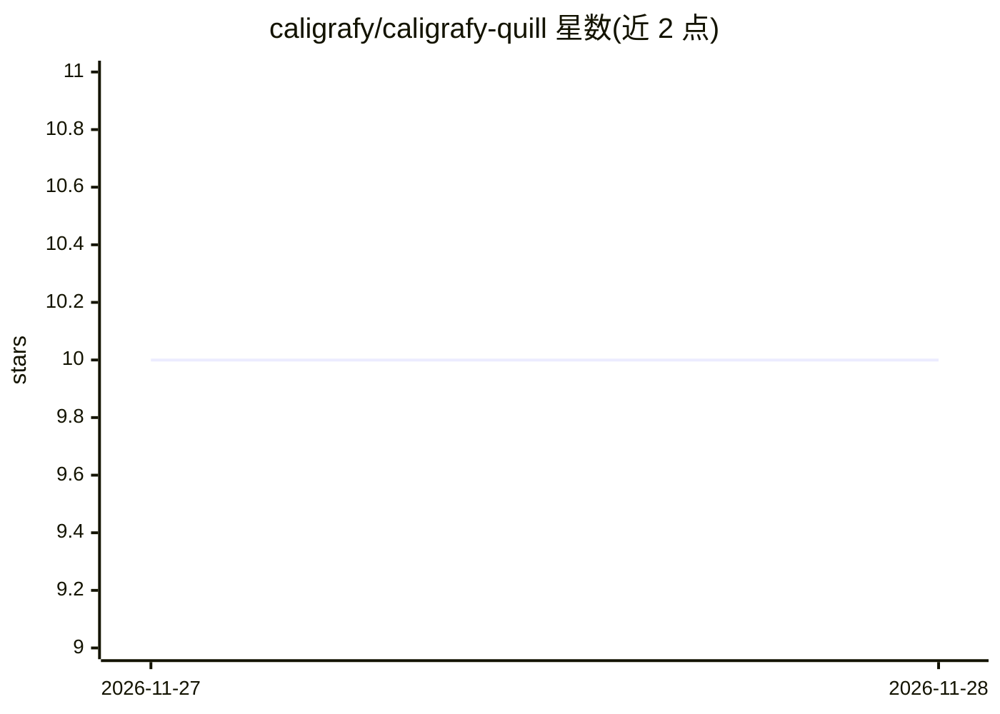

# caligrafy/caligrafy-quill

⭐ 10 · PHP · MIT · 推送 2026-11-27 · [GitHub](https://github.com/caligrafy/caligrafy-quill) · [官网](https://caligrafy.com) · 组织维护

**面向编码 agent 的 PHP MVC 框架：一次编写能力多端交付**

Caligrafy 是一个 PHP MVC 框架，将每个功能写成 capability（含输入、规则、权限），同一能力可同时作为网页、Vue 应用、iOS/Android 应用、REST API、MCP 工具（供 Claude/Cursor 等 agent 调用）与 Snap Cards 卡片使用，共享同一套规则与审计日志。支持 Claude Code 流程：描述想法、审批计划后由 agent 生成完整应用并部署到用户的 GitHub 仓库。内置支付、OpenAI 接入、人脸检测、机器学习等组件，生产镜像与 Dockerfile 提供，可选 SDK 通过 caligrafer add 添加。

## 筛选速览

| 维度 | 判定 | 备注 |
|---|---|---|
| AI 角色 | `ai-enhanced` | 去掉 AI 部分产品仍成立 |
| 许可风险 | `permissive` | MIT |
| 部署形态 | `self-host` | docker 或自建部署 |
| 模型依赖 | locked-api |  |
| 硬件要求 | — | 无带数字的原话,不猜 |
| 安装摩擦 | `low` | 无编译、无系统依赖或容器化 |
| 成熟度 | — | 结构信号不足 |

## 能力要点

- capability 一次编写，多渠道交付（页面/Vue/移动端/REST/MCP/Snap Cards）
- Claude Code 工作流：/caligrafy-quill:idea 从想法生成完整应用并上线
- Route::mcp() 将能力暴露为 AI agent 工具，llms.txt/AGENTS.md 供编码 agent 读取文档
- 生产 Dockerfile、异步服务器、CSRF 等安全默认项

## 适用场景

- 用 Claude Code 从一句话想法生成并部署完整 Web 应用
- 为同一后端同时提供 REST API 与 MCP agent 工具
- 一套代码生成 iOS/Android 应用并发布到应用商店
- 为团队构建带权限、审计与通知的全栈应用

## 场景标签

`代码生成` `人脸识别` · 领域:编码与开发

## 证据(README 行号)

> L8: **Why developers choose it.** A feature is written once, as a capability, and served to pages, Vue apps, REST, AI ag
> L56: The same capability is then a REST endpoint (`Route::capabilities()`), a tool for AI agents (`Route::mcp()`) and a
> L68: mobile`, signed in through your site), a **REST API**, **AI agents** such as Claude or Cursor over MCP, and

## 星数曲线

2026-11-27 10 → 2026-11-28 10（+0）

---
*卡片 v1 · prompt 1.4 · 生成 2026-11-27 · 置信度 high · 依据 README sha `76b29923b8ce` · [字段定义](../../DATASET.md)*
