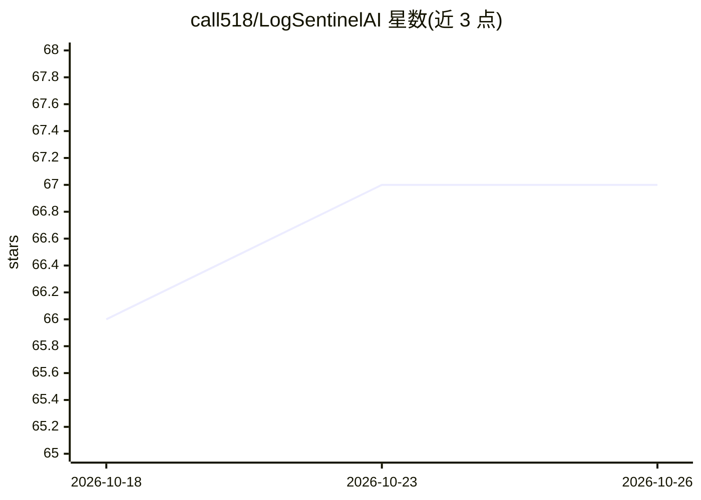

# call518/LogSentinelAI

⭐ 67 · Python · MIT · 推送 2026-10-24 · [GitHub](https://github.com/call518/LogSentinelAI) · [官网](https://deepwiki.com/call518/LogSentinelAI) · 个人维护

**用 Pydantic 声明式 Schema 让 LLM 分析安全日志的 DevSecOps 工具**

面向安全运维与开发者的日志分析 CLI 工具：以 Pydantic 类声明期望结果结构，由 LLM（OpenAI/Ollama/vLLM/Gemini/Claude）将 Apache、Linux 系统等非结构化日志抽取为经校验的结构化 JSON，无需 regex 规则。支持批处理与实时抽样两种模式，可从本地文件或 SSH 远端读取；输出索引到 Elasticsearch 并用 Kibana 可视化，CRITICAL 级事件触发 Telegram 告警。检测类型含 SQL 注入、XSS、暴力破解与网络异常。要求 Python 3.11/3.12（3.13+ 不支持），提供 Docker 部署方式。

## 筛选速览

| 维度 | 判定 | 备注 |
|---|---|---|
| AI 角色 | `ai-native` | 本体是模型或模型工具 |
| 许可风险 | `permissive` | MIT |
| 部署形态 | `library` | 以包/库形式分发 |
| 模型依赖 | local-ok | 支持本地模型 |
| 硬件要求 | — | 无带数字的原话,不猜 |
| 安装摩擦 | `low` | 无编译、无系统依赖或容器化 |
| 成熟度 | — | 结构信号不足 |

## 能力要点

- 声明 Pydantic Schema 即由 LLM 返回匹配该结构的 JSON，无需 regex
- 威胁检测：SQL 注入、XSS、暴力破解、网络异常
- 结果索引至 Elasticsearch，Kibana 可视化，CRITICAL 事件 Telegram 实时告警
- 支持 OpenAI/Ollama/vLLM/Gemini/Claude 多 LLM 提供方与本地部署

## 适用场景

- 把 Apache/Linux 日志转为结构化数据接入 SIEM
- 安全事件实时监控并通过 Telegram 接收严重告警
- 在数据不出内网的前提下（Ollama/vLLM 本地模型）做日志威胁分析
- 自定义专有日志格式，声明 Schema 即可分析，无需编写解析逻辑

## 场景标签

`网络安全` · 领域:学习与行业

## 证据(README 行号)

> L18: LogSentinelAI is an **AI-powered cybersecurity tool** that leverages LLM with **Declarative Extraction** to analyze
> L115: - **LLM Provider**: Integrates with external or local LLMs (e.g., OpenAI, vLLM, Ollama, Google Gemini, Anthropic C
> L122: - **Declarative Extraction**: Just declare your desired result structure (Pydantic class) and the LLM analyzes log

## 星数曲线

2026-10-18 66 → 2026-10-26 67（+1）

---
*卡片 v1 · prompt 1.4 · 生成 2026-10-24 · 置信度 high · 依据 README sha `3c160e70bfd2` · [字段定义](../../DATASET.md)*
