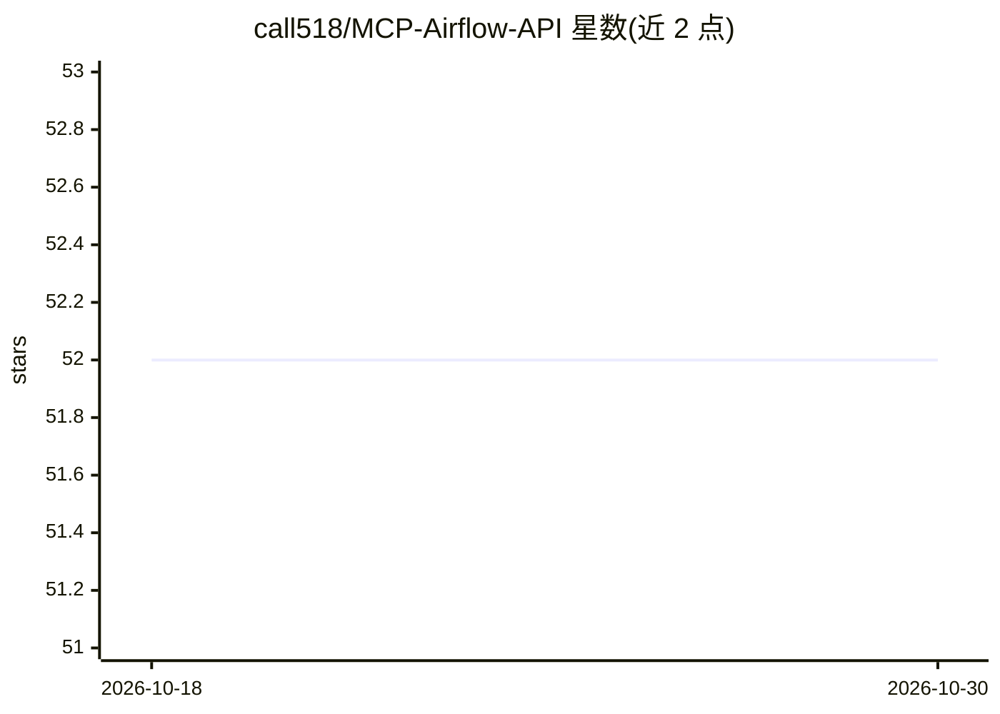

# call518/MCP-Airflow-API

⭐ 52 · Python · MIT · 推送 2026-10-28 · [GitHub](https://github.com/call518/MCP-Airflow-API) · [官网](https://deepwiki.com/call518/MCP-Airflow-API) · 个人维护

**用自然语言管理 Apache Airflow 的 MCP 服务器**

MCP-Airflow-API 是将 Apache Airflow REST API 操作封装为自然语言工具的 MCP 服务器：覆盖 DAG 管理、任务监控、Pool/变量/连接管理等 Airflow API v1（2.x，54 工具）与 v2（3.0+，56 工具，含 Asset 管理），通过 AIRFLOW_API_VERSION 环境变量动态切换版本。支持 stdio 与 streamable-http 两种传输模式，后者可启用 Bearer token 认证。可经 PyPI（uvx）、Claude Desktop 集成或源码安装，提供含 Open WebUI 与 MCPO 代理的 Docker Compose 演示环境；限制：v2 中 8 个 dataset 类工具返回不支持响应。

## 筛选速览

| 维度 | 判定 | 备注 |
|---|---|---|
| AI 角色 | `ai-ecosystem` | LLM/agent 周边工具 |
| 许可风险 | `permissive` | MIT |
| 部署形态 | `self-host` | docker 或自建部署 |
| 模型依赖 | locked-api |  |
| 硬件要求 | — | 无带数字的原话,不猜 |
| 安装摩擦 | `low` | 无编译、无系统依赖或容器化 |
| 成熟度 | — | 结构信号不足 |

## 能力要点

- Airflow 2.x/3.0+ 双 API 版本支持，环境变量动态切换
- 54-56 个 MCP 工具覆盖 DAG、任务、Pool、变量、连接、日志等
- stdio 与 streamable-http 双传输模式，支持 Bearer token 认证
- Docker Compose 演示环境（Open WebUI + MCP Server + MCPO 代理）

## 适用场景

- 通过 Claude/LLM 对话查看和操作 Airflow DAG 与任务
- 运维团队用自然语言监控大规模 Airflow 集群（1000+ DAG）
- 远程以 HTTP 模式带认证接入 Airflow 管理工具

## 场景标签

`MLOps` · 领域:训练与推理

## 证据(README 行号)

> L26: MCP-Airflow-API is an MCP server that leverages the **Model Context Protocol (MCP)** to transform Apache Airflow RE
> L172: - **Leveraging Model Context Protocol (MCP)**

## 星数曲线

2026-10-18 52 → 2026-10-30 52（+0）

---
*卡片 v1 · prompt 1.4 · 生成 2026-10-24 · 置信度 high · 依据 README sha `8da28da4c1fe` · [字段定义](../../DATASET.md)*
