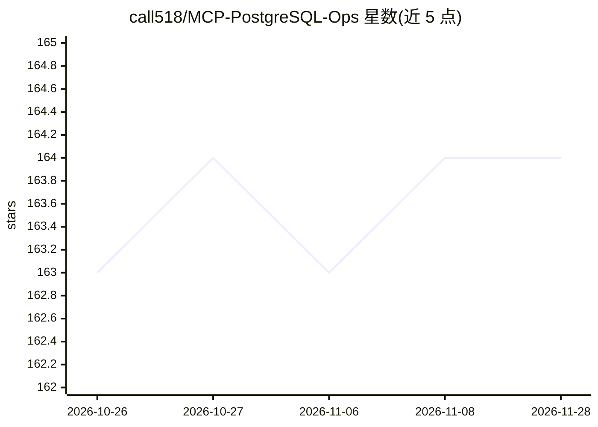

# call518/MCP-PostgreSQL-Ops

⭐ 164 · Python · MIT · 推送 2026-11-23 · [GitHub](https://github.com/call518/MCP-PostgreSQL-Ops) · [官网](https://deepwiki.com/call518/MCP-PostgreSQL-Ops) · 个人维护

**让 AI 助手通过 MCP 检查 PostgreSQL 运维状态的只读服务器**

一个 MCP 服务器，向 Claude Desktop、OpenWebUI 等 MCP 客户端提供 30+ 个只读 PostgreSQL 监控工具，覆盖慢查询、锁、膨胀、VACUUM/autovacuum、索引、复制、WAL 与容量等，通过自然语言提问转成预定义只读 SQL 并返回诊断证据。支持 PostgreSQL 12–18 并自动检测版本差异视图与列；核心工具无需扩展，pg_stat_statements 等可选。安装方式含 Claude Desktop 扩展（.mcpb）、uvx、Docker Compose（含 OpenWebUI 演示栈）与源码运行。

## 筛选速览

| 维度 | 判定 | 备注 |
|---|---|---|
| AI 角色 | `ai-ecosystem` | LLM/agent 周边工具 |
| 许可风险 | `permissive` | MIT |
| 部署形态 | `self-host` | docker 或自建部署 |
| 模型依赖 | local-ok | 支持本地模型 |
| 硬件要求 | — | 无带数字的原话,不猜 |
| 安装摩擦 | `low` | 无编译、无系统依赖或容器化 |
| 成熟度 | — | 结构信号不足 |

## 能力要点

- 30+ 只读工具：锁监控、膨胀检测、autovacuum、WAL、复制与容量统计
- 自动适配 PostgreSQL 12–18 的版本差异视图与列
- 仅执行预定义只读 SQL，不做任意 SQL 执行或数据修改
- 支持 Claude Desktop 扩展、uvx、Docker Compose、源码四种部署方式

## 适用场景

- 通过自然语言向 AI 助手查询数据库当前连接与阻塞会话
- 定位需要 VACUUM 的表和索引使用情况
- 在生产中用最小权限监控账号做只读健康巡检
- 兼容 RDS/Aurora 等托管数据库的监控

## 场景标签

 · 领域:数据库/运维工具

## 证据(README 行号)

> L21: MCP-PostgreSQL-Ops lets Claude, OpenWebUI, and other MCP clients inspect a
> L31: - **Deployment choice:** install a Claude Desktop extension, run with `uvx`, or
> L184: - **Multiple clients:** Claude Desktop, OpenWebUI, any Streamable HTTP MCP

## 星数曲线

2026-10-26 163 → 2026-11-28 164（+1）

---
*卡片 v1 · prompt 1.4 · 生成 2026-11-27 · 置信度 high · 依据 README sha `b17f29976300` · [字段定义](../../DATASET.md)*
