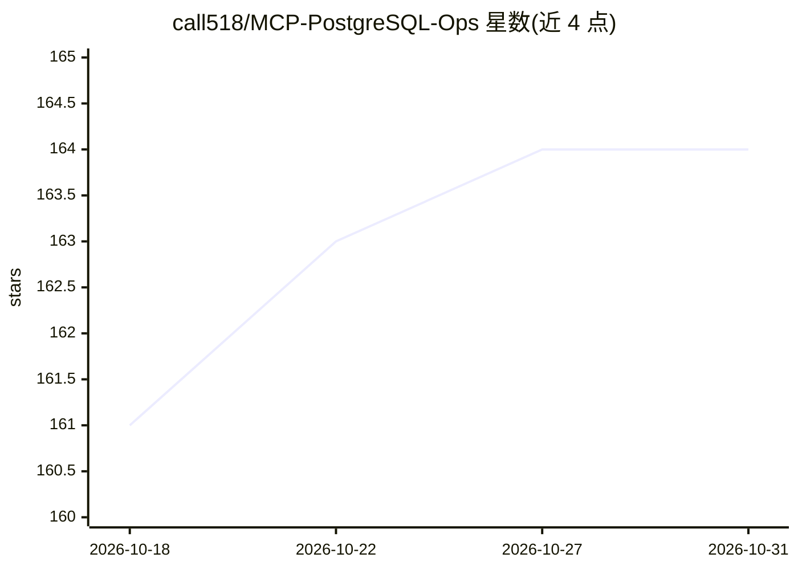

# call518/MCP-PostgreSQL-Ops

⭐ 164 · Python · MIT · 推送 2026-10-25 · [GitHub](https://github.com/call518/MCP-PostgreSQL-Ops) · [官网](https://deepwiki.com/call518/MCP-PostgreSQL-Ops) · 个人维护

**面向 AI 助手的 PostgreSQL 运维监控 MCP 服务器**

MCP-PostgreSQL-Ops 是一个用 Python 实现的 PostgreSQL 运维、监控与管理 MCP 服务器，面向通过 AI 助手以自然语言查询数据库状态的开发者与 DBA。提供 30 余个工具：连接/锁监控、bloat 检测、VACUUM 与 autovacuum 分析、schema 与关系发现、复制与 WAL 状态等，支持 PostgreSQL 12-18 并按版本自动适配。多数工具无需扩展，安装 pg_stat_statements / pg_stat_monitor 后可增强查询分析。操作以只读为主，兼容 RDS/Aurora 普通用户权限。提供 git clone 源码与 docker-compose 快速启动路径（内含测试数据库与 OpenWebUI）。

## 筛选速览

| 维度 | 判定 | 备注 |
|---|---|---|
| AI 角色 | `ai-ecosystem` | LLM/agent 周边工具 |
| 许可风险 | `permissive` | MIT |
| 部署形态 | `self-host` | docker 或自建部署 |
| 模型依赖 | — | README 未给出锁定关系 |
| 硬件要求 | — | 无带数字的原话,不猜 |
| 安装摩擦 | `low` | 无编译、无系统依赖或容器化 |
| 成熟度 | — | 结构信号不足 |

## 能力要点

- 30+ 只读运维工具：锁监控、bloat 检测、autovacuum 分析、复制/WAL 状态
- 支持 PostgreSQL 12-18，按版本自动适配（PG16+ pg_stat_io、PG17+ 等待事件目录、PG18+ 异步 I/O）
- 无需扩展即可使用大部分工具，可选 pg_stat_statements / pg_stat_monitor 增强
- RDS/Aurora 兼容，普通用户权限即可运行基础监控

## 适用场景

- 让 Claude 等 MCP 客户端用自然语言排查慢查询、锁与表膨胀
- 在 RDS/Aurora 等托管 PostgreSQL 上做日常监控
- 通过 OpenWebUI + Ollama/OpenAI 搭建数据库问答环境

## 场景标签

 · 领域:数据库运维/LLM 工具集成

## 证据(README 行号)

> L21: **MCP-PostgreSQL-Ops** is a professional MCP server for PostgreSQL database operations, monitoring, and management.
> L26: - ✅ **Natural Language**: Ask questions like "Show me slow queries" or "Analyze table bloat."

## 星数曲线

2026-10-18 161 → 2026-10-31 164（+3）

---
*卡片 v1 · prompt 1.4 · 生成 2026-10-22 · 置信度 high · 依据 README sha `512287df2c35` · [字段定义](../../DATASET.md)*
