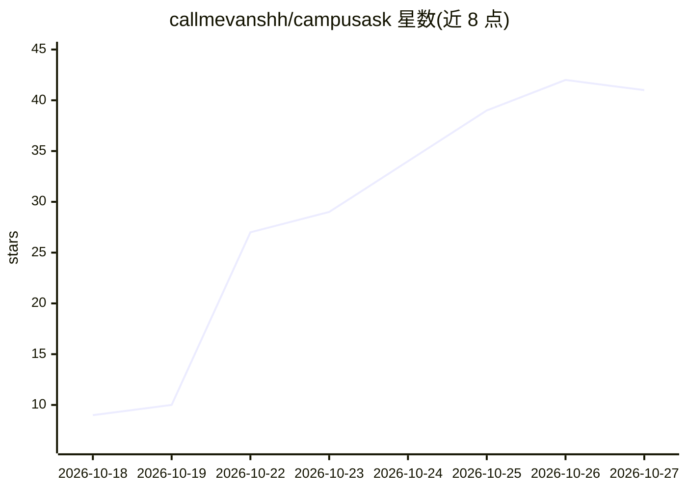

# callmevanshh/campusask

⭐ 41 · Python · MIT · 推送 2026-10-20 · [GitHub](https://github.com/callmevanshh/campusask) · [官网](https://campusask.onrender.com) · 个人维护

**基于官方 PDF 的 IIIT Delhi 校规引用问答应用**

面向学生的学术规则问答 Web 应用：仅从公开官方文档（约 380 个分块）检索回答，每条答案附文档、版本、章节、页码与 PDF 页面链接。检索用 BM25 关键词搜索（含词干化、纠错与同义词），生成用 Gemini Flash-Lite，模型只允许引用检索到的片段，无出处即答“未找到”。CGPA 规划的算术由 Python 计算而非模型。提供评价集、确定性 CI 测试与在线演示；明确声明为非官方学生项目，免费托管层限制塑造了缓存、限流与模型故障切换设计。

## 筛选速览

| 维度 | 判定 | 备注 |
|---|---|---|
| AI 角色 | `ai-native` | 本体是模型或模型工具 |
| 许可风险 | `permissive` | MIT |
| 部署形态 | `library` | 以包/库形式分发 |
| 模型依赖 | — | README 未给出锁定关系 |
| 硬件要求 | — | 无带数字的原话,不猜 |
| 安装摩擦 | `low` | 无编译、无系统依赖或容器化 |
| 成熟度 | — | 结构信号不足 |

## 能力要点

- 每条回答附文档/版本/章节/页码引用及 PDF 页面链接
- BM25 关键词检索（词干化、拼写纠错、程序名加权）
- CGPA 规划算术在 Python 中计算，模型仅抽取数字
- 无法回答时明确拒绝而非猜测；附 hit@k 评价集与 CI 检索门控

## 适用场景

- 查询学校学术规定、罚款政策、宿舍规则等
- 规划目标 CGPA 所需的成绩组合
- 核对答案原始出处（PDF 页面链接）

## 场景标签

`文档问答` · 领域:知识与检索

## 证据(README 行号)

> L5: Cited answers to questions about IIIT Delhi's academic rules and campus policies, drawn only from official public do
> L33: 5. **Answer:** the top chunks go to a Gemini Flash-Lite model that must use only those sources. On a quota error or

## 星数曲线

2026-10-18 9 → 2026-10-27 41（+32）

---
*卡片 v1 · prompt 1.4 · 生成 2026-10-25 · 置信度 mid · 依据 README sha `8e41f5755d39` · [字段定义](../../DATASET.md)*
