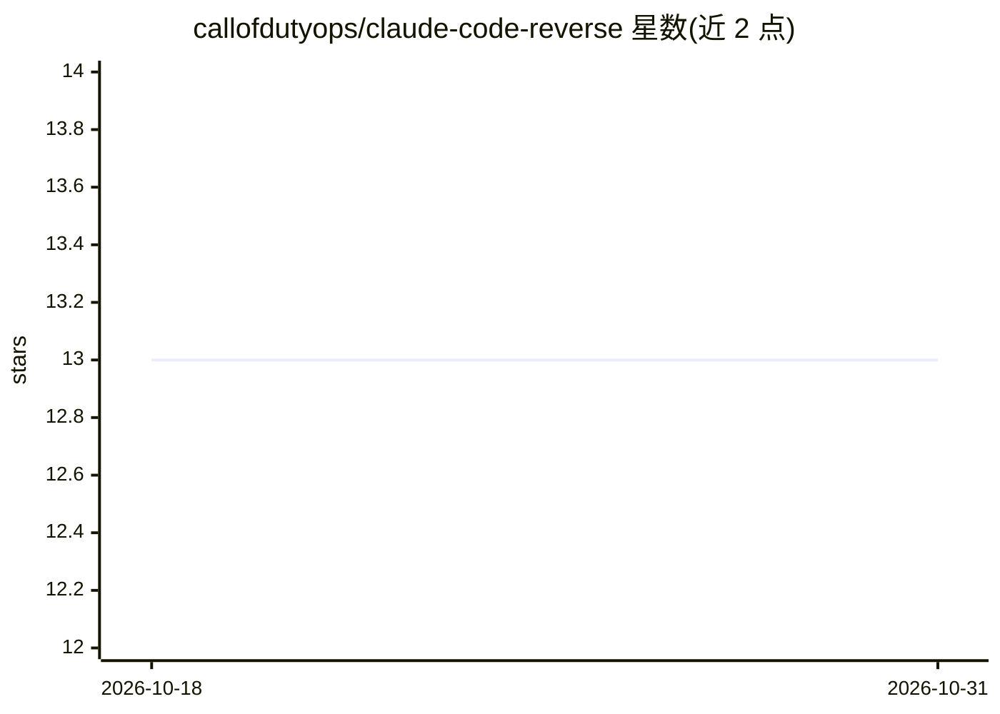

# callofdutyops/claude-code-reverse

⭐ 13 · TypeScript · MIT · 推送 2026-02-10 · [GitHub](https://github.com/callofdutyops/claude-code-reverse) · 个人维护

**本地透明代理：捕获 Claude Code 的 Anthropic API 调用并可视化分析**

用 TypeScript/Node.js 实现的本地反向代理工具：通过设置 ANTHROPIC_BASE_URL 将 Claude Code 的 API 请求转发经本机代理，捕获全部请求/响应存为 JSONL/SQLite，可提取 Claude Code 完整系统提示词、统计输入/输出/缓存 token 用量、分析工具调用频率与模式。提供 CLI 命令与 React 实时 Web 仪表盘（WebSocket 更新）。面向研究与调试用途，声明仅限教育目的、非 Anthropic 官方，并提醒日志可能含 API key 等敏感数据。需 Node.js 18+ 与已安装的 Claude Code CLI。

## 筛选速览

| 维度 | 判定 | 备注 |
|---|---|---|
| AI 角色 | `ai-ecosystem` | LLM/agent 周边工具 |
| 许可风险 | `permissive` | MIT |
| 部署形态 | `None` |  |
| 模型依赖 | — | README 未给出锁定关系 |
| 硬件要求 | — | 无带数字的原话,不猜 |
| 安装摩擦 | `low` | 无编译、无系统依赖或容器化 |
| 成熟度 | — | 结构信号不足 |

## 能力要点

- 透明代理拦截全部 API 调用，不修改 Claude Code 本体
- 提取并导出 Claude Code 完整系统提示词
- token 与缓存命中统计、工具调用模式分析
- 数据落地 JSONL/SQLite，附 React 实时仪表盘

## 适用场景

- 研究 Claude Code 的系统提示词与工具定义结构
- 调试基于 Claude 的应用时分析请求/响应模式
- 追踪 token 用量与缓存命中率以优化成本

## 场景标签

`LLM 可观测性` · 领域:评测与运维

## 证据(README 行号)

> L7: A reverse engineering tool for intercepting, logging, and visualizing Claude Code LLM interactions. Useful for under
> L25: - **Token Statistics**: Track input/output/cache token usage per session
> L26: - **Tool Usage Analysis**: Monitor tool call frequency and patterns

## 星数曲线

2026-10-18 13 → 2026-10-31 13（+0）

---
*卡片 v1 · prompt 1.4 · 生成 2026-10-31 · 置信度 high · 依据 README sha `4aa816e2c2ce` · [字段定义](../../DATASET.md)*
