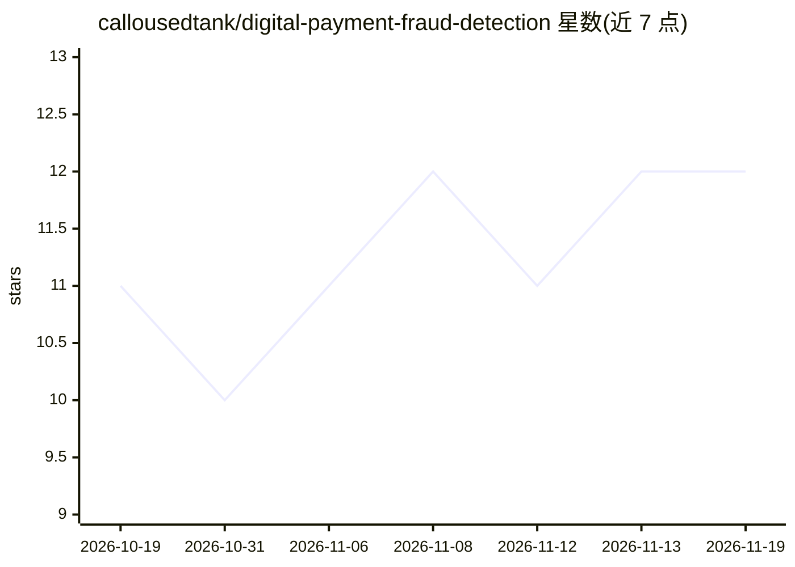

# callousedtank/digital-payment-fraud-detection

⭐ 12 · Python · 推送 2026-09-22 · [GitHub](https://github.com/callousedtank/digital-payment-fraud-detection) · 个人维护

**支付欺诈检测的端到端 ML 系统：训练+推理 API+容器化部署**

覆盖数据集评估、不平衡感知训练、实验跟踪、模型版本化的完整 ML 工程流程，并通过 FastAPI 提供带请求校验、健康检查与指标端点的推理服务。支持两套数据集（自采集数字支付数据集与 ULB 信用卡基准）按配置切换预处理与重采样策略；训练产物带版本化注册表，可在不重训的情况下激活历史版本。提供 Streamlit 客户端、Pytest 测试套件与 Docker/Podman 容器化，已部署于 Render。

## 筛选速览

| 维度 | 判定 | 备注 |
|---|---|---|
| AI 角色 | `ai-native` | 本体是模型或模型工具 |
| 许可风险 | `none` | — |
| 部署形态 | `self-host` | docker 或自建部署 |
| 模型依赖 | — | README 未给出锁定关系 |
| 硬件要求 | — | 无带数字的原话,不猜 |
| 安装摩擦 | `low` | 无编译、无系统依赖或容器化 |
| 成熟度 | `idea` | |

## 能力要点

- 模型注册表支持版本化产物与不重训的版本激活/回滚
- SMOTENC/SMOTE 不平衡重采样仅作用于训练集划分
- JSONL 实验跟踪记录数据集 SHA-256 指纹与验证指标
- FastAPI + Pydantic 校验、健康/就绪/指标端点

## 适用场景

- 为交易数据训练并部署欺诈预测推理 API
- 多版本模型切换与回滚的注册表管理
- 在数据集信号弱时用公开基准分离数据问题与管线问题
- 用 Streamlit 界面提交交易并查看欺诈概率

## 场景标签

`MLOps` · 领域:训练与推理

## 证据(README 行号)

> L3: An end-to-end machine learning system for detecting fraudulent digital payment transactions, covering dataset evalua
> L9: **API:** https://digital-payment-fraud-detection.onrender.com
> L50: |Machine Learning|scikit-learn, imbalanced-learn|

## 星数曲线

2026-10-19 11 → 2026-11-19 12（+1）

---
*卡片 v1 · prompt 1.4 · 生成 2026-11-18 · 置信度 mid · 依据 README sha `d1997a00065b` · [字段定义](../../DATASET.md)*
