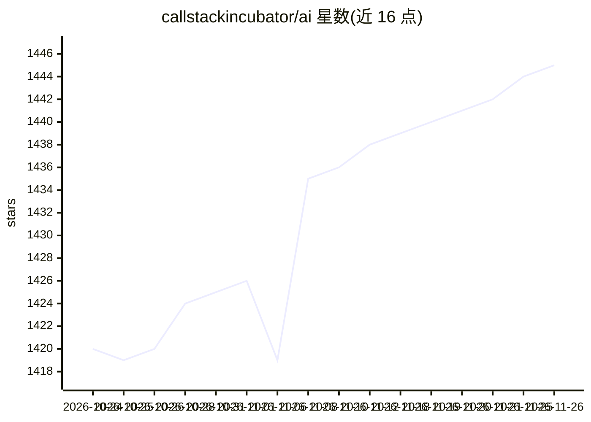

# callstackincubator/ai

⭐ 1,445 · TypeScript · MIT · 推送 2026-11-11 · [GitHub](https://github.com/callstackincubator/ai) · [官网](https://react-native-ai.dev) · 组织维护

**React Native 端侧 LLM 运行库，兼容 Vercel AI SDK**

为 React Native 应用提供端侧 AI 原语集合，通过多个 provider 包在用户设备上直接运行模型，无需服务器与 API key（云模型为可选项）。内置 Apple Foundation Models 与 Android Gemini Nano（经 ML Kit GenAI）两条系统模型通道，另有 Core AI 运行时与基于 llama.rn 的 GGUF 模型通道（需从 HuggingFace 下载）。能力覆盖文本生成、嵌入、语音转写/合成、图像与视频生成及视觉任务；API 与 Vercel AI SDK 的 generateText/streamText/embed 等函数对齐，并附 DevTools Profiler 插件采集 OpenTelemetry span。各 provider 按平台有 iOS/Android 版本要求。

## 筛选速览

| 维度 | 判定 | 备注 |
|---|---|---|
| AI 角色 | `ai-ecosystem` | LLM/agent 周边工具 |
| 许可风险 | `permissive` | MIT |
| 部署形态 | `library` | 以包/库形式分发 |
| 模型依赖 | — | README 未给出锁定关系 |
| 硬件要求 | — | 无带数字的原话,不猜 |
| 安装摩擦 | `low` | 无编译、无系统依赖或容器化 |
| 成熟度 | — | 结构信号不足 |

## 能力要点

- 兼容 Vercel AI SDK 的 generateText/streamText/embed 等函数调用本地模型
- 内置 Apple 与 Android 系统模型通道，无需下载模型与 API key
- 支持 GGUF 模型（经 llama.rn），覆盖文本、嵌入与语音
- JSON UI：工具调用模型可构建 React Native 界面

## 适用场景

- 在移动应用中离线运行 LLM，数据不出设备
- 为 React Native 应用添加转写、嵌入或图像生成能力
- 用熟悉的 AI SDK API 接入端侧小模型

## 场景标签

`推理引擎` · 领域:训练与推理

## 证据(README 行号)

> L5: A collection of on-device AI primitives for React Native with first-class Vercel AI SDK support. Run AI models direc
> L11: - 🎯 **Vercel AI SDK compatible** - Use `generateText`, `streamText`, `embed` and other AI SDK functions with local 
> L43: |Provider|Built-in|Platforms|Runtime|Description|

## 星数曲线

2026-10-24 1,420 → 2026-11-26 1,445（+25）

---
*卡片 v1 · prompt 1.4 · 生成 2026-11-23 · 置信度 high · 依据 README sha `bfb41e78678e` · [字段定义](../../DATASET.md)*
