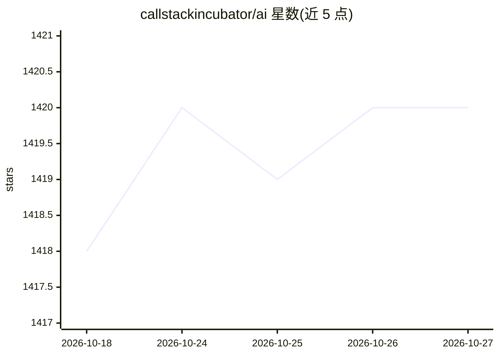

# callstackincubator/ai

⭐ 1,420 · TypeScript · MIT · 推送 2026-10-26 · [GitHub](https://github.com/callstackincubator/ai) · [官网](https://react-native-ai.dev) · 组织维护

**React Native 端侧 LLM 开发库，兼容 Vercel AI SDK**

面向 React Native 开发者的端侧 AI 原语集合：通过 Apple 系统模型（Foundation Models、嵌入、转写、语音合成）、llama.rn 运行 GGUF 模型、MLC LLM 运行开源模型三条通道，在用户设备上完成文本生成、嵌入、语音转写与合成，数据不离开本地。API 兼容 Vercel AI SDK（0.11 以下对应 v5、0.12 以上对应 v6）。各 provider 以独立 npm 包分发；Llama 与 MLC 需下载模型，Apple 内置无需下载；文本生成需 iOS 26+ 且 Apple Intelligence 设备。另含基于 OpenTelemetry 的 DevTools 性能分析插件与 agent skills。

## 筛选速览

| 维度 | 判定 | 备注 |
|---|---|---|
| AI 角色 | `ai-ecosystem` | LLM/agent 周边工具 |
| 许可风险 | `permissive` | MIT |
| 部署形态 | `library` | 以包/库形式分发 |
| 模型依赖 | local-ok | 支持本地模型 |
| 硬件要求 | — | 无带数字的原话,不猜 |
| 安装摩擦 | `low` | 无编译、无系统依赖或容器化 |
| 成熟度 | — | 结构信号不足 |

## 能力要点

- Apple/llama.rn/MLC 三种端侧推理通道，覆盖 iOS 与 Android（Llama/MLC）
- Vercel AI SDK 兼容 API，按版本对应 v5/v6
- 端到端能力：文本生成、嵌入、语音转写、语音合成
- AI SDK Profiler 插件经 OpenTelemetry 捕获请求并在 DevTools 展示

## 适用场景

- 在 React Native 应用中集成离线 LLM 对话与 RAG 嵌入
- iOS 应用直接调用系统模型实现免下载的 AI 功能
- 为端侧 AI 应用做隐私合规与性能剖析

## 场景标签

`语音合成` `语音识别` · 领域:内容生成

## 证据(README 行号)

> L5: A collection of on-device AI primitives for React Native with first-class Vercel AI SDK support. Run AI models direc
> L11: - 🎯 **Vercel AI SDK compatible** - Drop-in replacement with familiar APIs

## 星数曲线

2026-10-18 1,418 → 2026-10-27 1,420（+2）

---
*卡片 v1 · prompt 1.4 · 生成 2026-10-21 · 置信度 high · 依据 README sha `cfa330eef901` · [字段定义](../../DATASET.md)*
