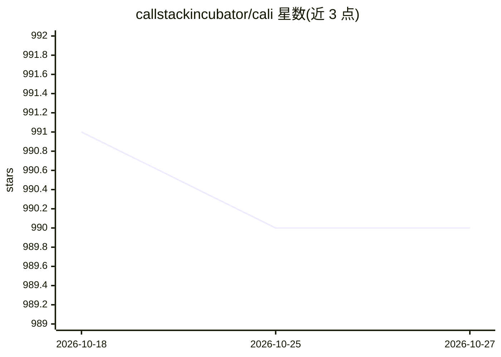

# callstackincubator/cali

⭐ 990 · TypeScript · MIT · 推送 2026-07-01 · [GitHub](https://github.com/callstackincubator/cali) · 组织维护

**面向 React Native 团队的 AI agent CLI：QA、代码审查与实现流程**

角色化 CLI 工具，为 React Native 与 Expo 团队提供可重复的移动端 QA、PR 审查、性能审查与实现流程：确定性配置留在 CLI 内，按命令暴露受限的工具包（agent-device、repo-read 等），通过 cali-context.json 共享上下文契约，输出结构化报告，支持本地模拟器/真机模式与 GitHub Actions、EAS CI 环境。模型接入支持 AI Gateway 或 Anthropic 直连（默认 openai/gpt-5.4-mini，直连仅支持 Anthropic）。review/perf-review/dev 命令标注为实验性。

## 筛选速览

| 维度 | 判定 | 备注 |
|---|---|---|
| AI 角色 | `ai-native` | 本体是模型或模型工具 |
| 许可风险 | `permissive` | MIT |
| 部署形态 | `library` | 以包/库形式分发 |
| 模型依赖 | locked-api |  |
| 硬件要求 | — | 无带数字的原话,不猜 |
| 安装摩擦 | `low` | 无编译、无系统依赖或容器化 |
| 成熟度 | `idea` | |

## 能力要点

- qa/review/perf-review/dev 四个角色化命令，按命令限定工具包
- 本地 --local android|ios 模式与 GitHub Actions/EAS 自动检测
- 统一 cali-context.json 上下文契约，凭据 URL 脱敏后写入报告
- 缺技能时用 npx skills 自动安装到 ~/.cali/skills

## 适用场景

- 在本地模拟器或 CI 上对 React Native 应用跑 AI 移动端 QA
- 对 PR 做发现优先的代码审查并输出结构化报告
- 按提示词让 agent 执行仓库实现任务（实验性）

## 场景标签

`代码审查` `编码 Agent` · 领域:编码与开发

## 证据(README 行号)

> L3: Cali v2 is a role-oriented CLI for React Native and Expo teams that want repeatable mobile QA, review, performance r
> L24: - `cali qa`
> L99: ### AI Gateway

## 星数曲线

2026-10-18 991 → 2026-10-27 990（-1）

---
*卡片 v1 · prompt 1.4 · 生成 2026-10-21 · 置信度 mid · 依据 README sha `ba56dfed19d2` · [字段定义](../../DATASET.md)*
