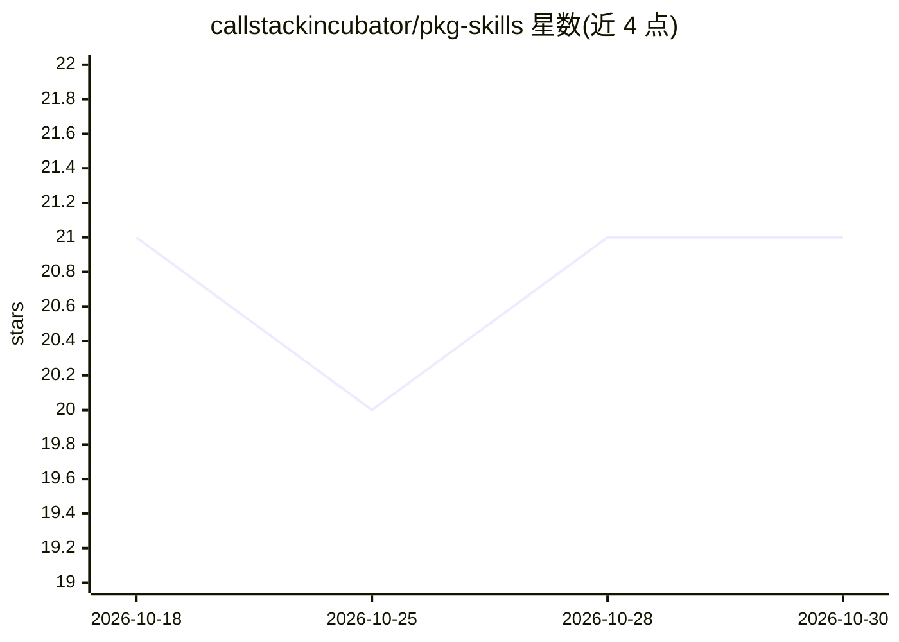

# callstackincubator/pkg-skills

⭐ 21 · TypeScript · NOASSERTION · 推送 2026-10-29 · [GitHub](https://github.com/callstackincubator/pkg-skills) · 组织维护

**按项目依赖推荐并管理 React Native agent 技能的 CLI**

Callstack 维护的 npm CLI：递归扫描项目下所有 package.json，将发现的库与一份维护的查找表比对，底层调用 Vercel skills CLI 报告、安装或移除对应 agent 技能。提供交互与自动化两种模式，支持报告、更新、列出支持映射等命令；monorepo 可限 workspace 扫描并用 .pkg-skillsignore 等配置文件控制；查找表默认从 GitHub 拉取最新版，失败时回退内置副本。映射技能来源于 Callstack、Software Mansion、Vercel 等仓库。

## 筛选速览

| 维度 | 判定 | 备注 |
|---|---|---|
| AI 角色 | `ai-ecosystem` | LLM/agent 周边工具 |
| 许可风险 | `none` | NOASSERTION |
| 部署形态 | `desktop` | 安装包/桌面程序 |
| 模型依赖 | — | README 未给出锁定关系 |
| 硬件要求 | — | 无带数字的原话,不猜 |
| 安装摩擦 | `low` | 无编译、无系统依赖或容器化 |
| 成熟度 | — | 结构信号不足 |

## 能力要点

- 扫描 package.json 依赖并对照查找表推荐技能
- 交互/auto 模式支持安装、更新与清理托管技能
- monorepo 支持 workspace-only 扫描与路径忽略
- CI 友好：--json、--dry-run、离线查找表回退

## 适用场景

- 为 React Native 项目按依赖自动配齐 agent 技能
- monorepo 中查看各包声明的库对应哪些技能
- 在 CI 中用 JSON 输出比对分支间的技能推荐差异

## 场景标签

 · 领域:开发者工具/agent 技能管理

## 证据(README 行号)

> L8: CLI for recommending and managing React Native agent skills from detected project dependencies, with curated mapping
> L10: It scans every `package.json` under the target directory, compares discovered libraries against a curated lookup ta

## 星数曲线

2026-10-18 21 → 2026-10-30 21（+0）

---
*卡片 v1 · prompt 1.4 · 生成 2026-10-28 · 置信度 high · 依据 README sha `6b7ca8f09731` · [字段定义](../../DATASET.md)*
