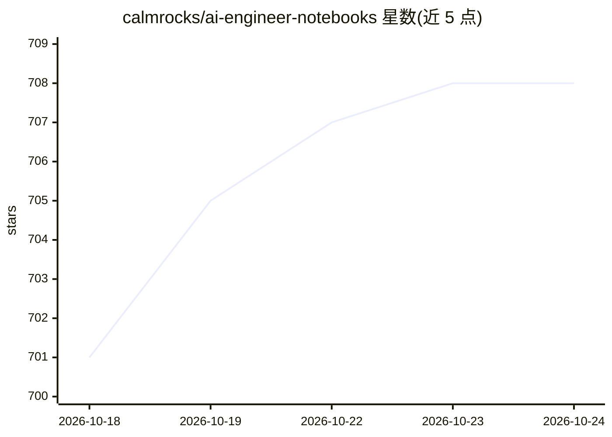

# calmrocks/ai-engineer-notebooks

⭐ 708 · Jupyter Notebook · MIT · 推送 2026-10-08 · [GitHub](https://github.com/calmrocks/ai-engineer-notebooks) · [官网](https://www.calm.rocks/resources/career-development/transition-fde-ai-engineer/) · 个人维护

**面向 AI Engineer/FDE 的动手 Colab 笔记本教程集**

一套无框架的可运行 Colab 笔记本，覆盖应用 LLM 技能栈：模型 API、结构化输出、工具调用、RAG、评测、Agent（从零写循环、工具设计、护栏、MCP、Skills）、LoRA 微调、提示注入安全、LLMOps 与推理服务性能。全程用原生 API 而非框架，默认跑在免费 Groq API 上；LoRA 微调与自托管服务等 Groq 无法托管的主题以概念讲解为主并附 Colab-GPU 可选附录（在真实 T4 上验证过）。面向转型 AI Engineer/FDE 的后端或全栈工程师，含三个端到端案例与一个简历级毕业项目。

## 筛选速览

| 维度 | 判定 | 备注 |
|---|---|---|
| AI 角色 | `ai-knowledge` | 知识聚合/清单类 |
| 许可风险 | `permissive` | MIT |
| 部署形态 | `library` | 以包/库形式分发 |
| 模型依赖 | locked-api |  |
| 硬件要求 | — | 无带数字的原话,不猜 |
| 安装摩擦 | `low` | 无编译、无系统依赖或容器化 |
| 成熟度 | — | 结构信号不足 |

## 能力要点

- 无框架设计：用原生 API 从零实现 agent 循环、RAG 与评测
- 全流程在免费 Groq API 上运行，无需信用卡
- LoRA 微调与自托管服务主题附 Colab-GPU 可选附录（T4 验证）
- 三个端到端案例（生产调试、pipeline vs agent 成本对比、红队鲁棒性基准）

## 适用场景

- 后端/全栈工程师系统学习 AI Engineer / FDE 技能栈
- 在 Colab 上免费动手实践 RAG、评测与 Agent 开发
- 为简历准备一个含服务组件与评测报告的部署项目

## 场景标签

`教程课程` `RAG` `模型评测` `微调` · 领域:评测与运维

## 证据(README 行号)

> L11: Runnable Colab notebooks for the **AI Engineer / Forward Deployed Engineer (FDE)**
> L17: - **Framework-free, on purpose.** You write the agent loop, RAG, and evals from
> L24: - **Free to run, end to end.** Everything runs on the **free

## 星数曲线

2026-10-18 701 → 2026-10-24 708（+7）

---
*卡片 v1 · prompt 1.4 · 生成 2026-10-21 · 置信度 high · 依据 README sha `e07efc7ae068` · [字段定义](../../DATASET.md)*
