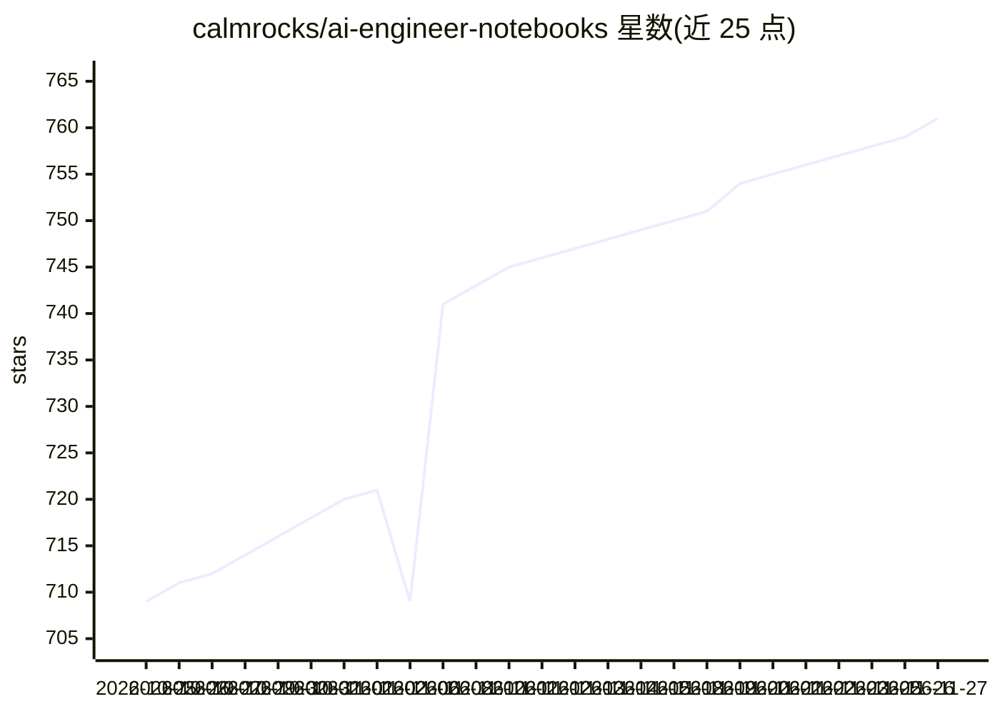

# calmrocks/ai-engineer-notebooks

⭐ 761 · Jupyter Notebook · MIT · 推送 2026-11-07 · [GitHub](https://github.com/calmrocks/ai-engineer-notebooks) · [官网](https://www.calm.rocks/resources/career-development/transition-fde-ai-engineer/) · 个人维护

**面向 AI 工程师的免框架 Colab 实战教程笔记本集**

一组可在 Colab 直接运行的 Jupyter 笔记本，按学习顺序覆盖模型 API、结构化输出、工具调用、RAG、评测、Agent（含 MCP 与 Skills）、LoRA 微调、提示注入安全、LLMOps 与推理服务设计，共 12 个章节加 4 个案例研究与毕业项目。全程使用原始 API 而非框架编写代码，默认运行在免费 Groq API 上，OpenAI 兼容格式可迁移；GPU 相关主题（LoRA、自托管服务）以概念讲解为主并附可选 Colab GPU 附录。面向转型 AI 工程师/FDE 的后端或全栈工程师，每个笔记本自带依赖安装、Colab secrets 读密钥并以练习收尾。

## 筛选速览

| 维度 | 判定 | 备注 |
|---|---|---|
| AI 角色 | `ai-knowledge` | 知识聚合/清单类 |
| 许可风险 | `permissive` | MIT |
| 部署形态 | `library` | 以包/库形式分发 |
| 模型依赖 | locked-api |  |
| 硬件要求 | — | 无带数字的原话,不猜 |
| 安装摩擦 | `low` | 无编译、无系统依赖或容器化 |
| 成熟度 | — | 结构信号不足 |

## 能力要点

- 免框架教学：agent loop、RAG、评测均用原始 API 编写
- 全程基于免费 Groq API，OpenAI 兼容格式可迁移
- 以评测为主线（golden sets、LLM as judge、回归评测）
- 4 个端到端案例研究与 1 个求职毕业项目

## 适用场景

- 系统学习应用层 LLM 工程技能（RAG、Agent、评测）
- 准备 AI Engineer / FDE 岗位面试
- 免费 API 环境下动手练写 agent loop 与 RAG
- 为简历构建带评测报告的部署项目

## 场景标签

`教程课程` · 领域:学习与行业

## 证据(README 行号)

> L11: Runnable Colab notebooks for the **AI Engineer / Forward Deployed Engineer (FDE)**
> L17: - **Framework-free, on purpose.** You write the agent loop, RAG, and evals from
> L49: Work top to bottom. Each notebook is self-contained (installs its own

## 星数曲线

2026-10-25 709 → 2026-11-27 761（+52）

---
*卡片 v1 · prompt 1.4 · 生成 2026-11-25 · 置信度 high · 依据 README sha `9418ccde8391` · [字段定义](../../DATASET.md)*
