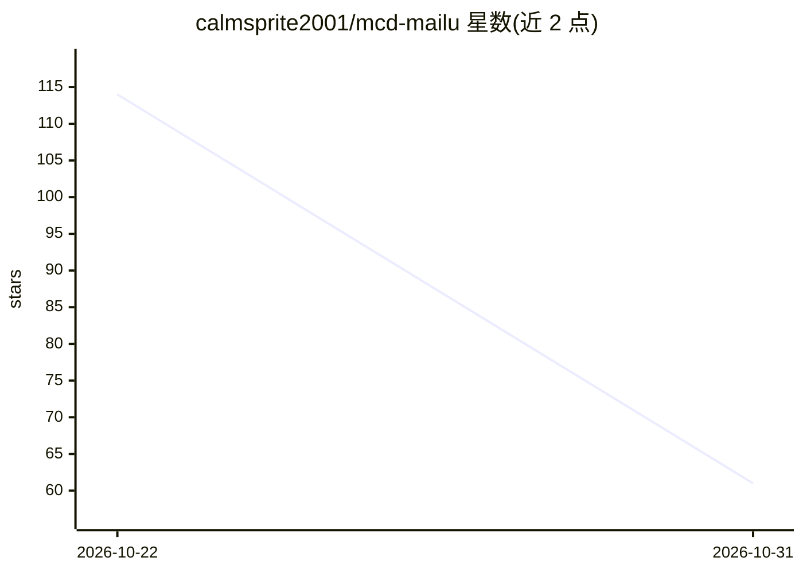

# calmsprite2001/mcd-mailu

⭐ 61 · Python · 推送 2026-10-19 · [GitHub](https://github.com/calmsprite2001/mcd-mailu) · 个人维护 · 中文 README

**读取麦当劳历史订单，生成可回溯真实订单的场景叙事足迹卡**

基于麦当劳官方 MCP 的消费叙事 Skill：读取用户历史订单，从门店名与下单时间识别场景（机场、赶早班、加班等），按「到访」口径做模式识别，输出每句话带 evidence（订单号集合）的 HTML 轨迹卡；样本不足 10 单时改按时间逐单叙述。面向麦当劳常客、出差通勤人群与想参考 MCP 用法的开发者。纯 Python 标准库实现（3.10+），订单数据内存计算不落盘，可在 WorkBuddy/Cherry Studio/Cursor 中作为 MCP Skill 使用，也提供无 Token 的 demo 模式（88 单构造样本）。

## 筛选速览

| 维度 | 判定 | 备注 |
|---|---|---|
| AI 角色 | `ai-native` | 本体是模型或模型工具 |
| 许可风险 | `none` | — |
| 部署形态 | `None` |  |
| 模型依赖 | — | README 未给出锁定关系 |
| 硬件要求 | — | 无带数字的原话,不猜 |
| 安装摩擦 | `low` | 无编译、无系统依赖或容器化 |
| 成熟度 | — | 结构信号不足 |

## 能力要点

- 每句叙事带 evidence 订单号集合，校验不过不写入
- 按「到访」而非「按订单」统计，避免连点污染画像
- 场景识别词典（references/scene_rules.md）开放透明，接受 PR
- 订单明细不落盘、Token 仅从环境变量读取

## 适用场景

- 把一年的麦当劳消费记录生成可截图分享的足迹卡
- 回顾自己的消费场景，看常点餐品与出行规律
- 开发者参考 MCP 数据的场景化叙事用法

## 场景标签

`数据分析` · 领域:效率与自动化

## 证据(README 行号)

> L9: 基于麦当劳官方 MCP 的消费轨迹与场景叙事 Skill。读取你的历史订单，识别出「这次在机场」「这次是赶早班」「这次在机场连点了两单」，把你的麦当劳历史讲成一个**每句话都能回溯到真实订单**的故事，输出一张可截图分享的轨迹卡。
> L62: **卡片上的每一句话，都必须能回溯到至少一条真实订单。**

## 星数曲线

2026-10-22 114 → 2026-10-31 61（-53）

---
*卡片 v1 · prompt 1.4 · 生成 2026-10-30 · 置信度 high · 依据 README sha `b8d81c59a274` · [字段定义](../../DATASET.md)*
