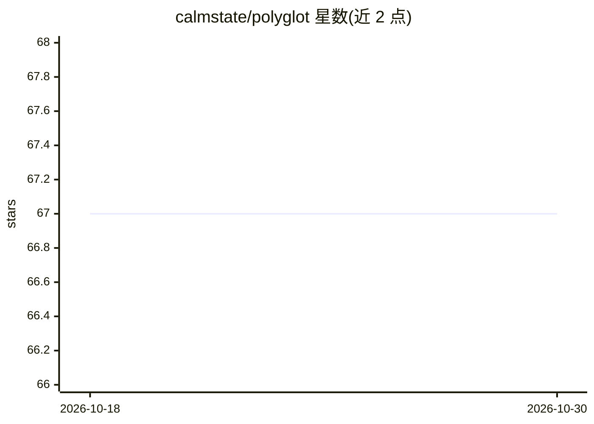

# calmstate/polyglot

⭐ 67 · JavaScript · MIT · 推送 2025-11-21 · [GitHub](https://github.com/calmstate/polyglot) · 个人维护

**基于 Ollama LLM 的 Windows 免费文本翻译工具**

面向终端用户的桌面翻译应用，调用本地 Ollama 提供的 LLM 进行多语言文本翻译；除 Ollama 外也可接入任何提供兼容 API 的后端。以 Neutralino 框架构建，Windows 用户可从 releases 页下载发行包直接运行，其他平台需 NodeJS v20+ 环境下通过 Neutralino CLI（neu run）从源码运行。README 声明本项目已在此账号停止维护，并指向另一账号的后续版本。

## 筛选速览

| 维度 | 判定 | 备注 |
|---|---|---|
| AI 角色 | `ai-native` | 本体是模型或模型工具 |
| 许可风险 | `permissive` | MIT |
| 部署形态 | `desktop` | 安装包/桌面程序 |
| 模型依赖 | local-ok | 支持本地模型 |
| 硬件要求 | — | 无带数字的原话,不猜 |
| 安装摩擦 | `low` | 无编译、无系统依赖或容器化 |
| 成熟度 | — | 结构信号不足 |

## 能力要点

- 通过 Ollama LLM 完成多语言文本翻译
- 兼容任何提供兼容 API 的后端
- Windows 发行包可直接下载运行
- 基于 Neutralino，源码运行需 NodeJS v20+

## 适用场景

- 日常文本的多语言翻译
- 本地运行 LLM 进行翻译，不依赖云端翻译服务

## 场景标签

 · 领域:翻译工具/桌面应用

## 证据(README 行号)

> L5: Polyglot is innovative software that utilizes LLMs with Ollama to translate texts in a practical, fast, convenient, 
> L11: - 🌟 **Multilingual Translation**: Translate texts into various languages quickly and accurately using Ollama's LLM 

## 星数曲线

2026-10-18 67 → 2026-10-30 67（+0）

---
*卡片 v1 · prompt 1.4 · 生成 2026-10-24 · 置信度 high · 依据 README sha `de25555816dd` · [字段定义](../../DATASET.md)*
