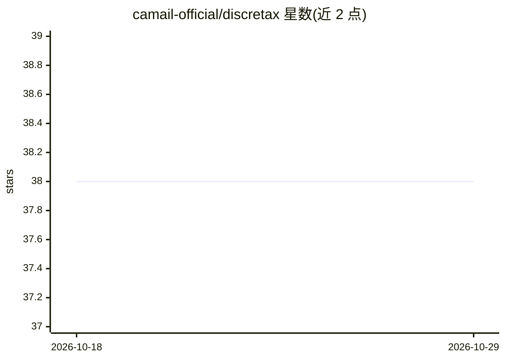

# camail-official/discretax

⭐ 38 · Python · MIT · 推送 2026-03-09 · [GitHub](https://github.com/camail-official/discretax) · [官网](https://www.camail.org/discretax) · 组织维护

**面向 JAX 用户的轻量级状态空间模型实现集合**

基于 JAX/Equinox 实现的状态空间模型（SSM）库，模块化设计，收录 DeltaNet、LinOSS、LRU、S5、S4D 等序列模型的可复用实现，每项实现附对应论文与参考代码链接。提供即用型示例 notebook，支持 CPU 与 CUDA 12 两种安装变体。由 Computational Applied Mathematics & AI Lab（T. Konstantin Rusch 领导）维护，2026 年 3 月由 linax 更名为 discretax，此前发布过首个 beta 版本。

## 筛选速览

| 维度 | 判定 | 备注 |
|---|---|---|
| AI 角色 | `ai-native` | 本体是模型或模型工具 |
| 许可风险 | `permissive` | MIT |
| 部署形态 | `library` | 以包/库形式分发 |
| 模型依赖 | — | README 未给出锁定关系 |
| 硬件要求 | — | 无带数字的原话,不猜 |
| 安装摩擦 | `low` | 无编译、无系统依赖或容器化 |
| 成熟度 | `idea` | |

## 能力要点

- 5 种状态空间模型实现：DeltaNet、LinOSS、LRU、S5、S4D
- JAX/Equinox 实现，模块化、按论文对应
- 提供即用型示例 notebook
- 支持 CPU 与 cu12（GPU）两种安装变体

## 适用场景

- 在 JAX 项目中复用 S4D/S5/LRU 等序列模型层
- 对比不同状态空间模型在长序列任务上的表现
- 基于示例 notebook 快速上手状态空间模型

## 场景标签

 · 领域:深度学习/序列建模

## 证据(README 行号)

> L12: discretax is a collection of state space models implemented in JAX. It is
> L96: |Year|Model|Paper|Code|Our implementation|
> L114: This work has been carried out within the Computational Applied Mathematics & AI Lab,

## 星数曲线

2026-10-18 38 → 2026-10-29 38（+0）

---
*卡片 v1 · prompt 1.4 · 生成 2026-10-25 · 置信度 high · 依据 README sha `0ed8a5b36777` · [字段定义](../../DATASET.md)*
