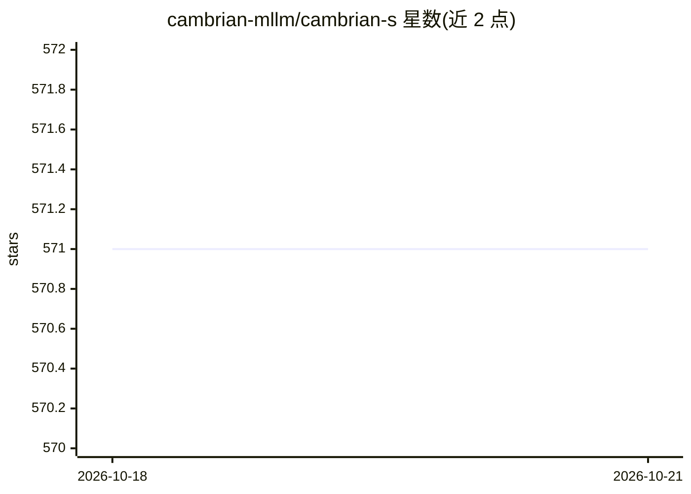

# cambrian-mllm/cambrian-s

⭐ 571 · Python · Apache-2.0 · 推送 2026-04-03 · [GitHub](https://github.com/cambrian-mllm/cambrian-s) · [官网](https://cambrian-mllm.github.io/) · 组织维护

**面向视频空间理解的多模态大模型，含数据集与训练评测代码**

Cambrian-S 是以视频空间感知（spatial supersensing）为目标的多模态大语言模型系列，提供 0.5B–7B 多个规模检查点，基座为 Qwen2.5-Instruct、视觉编码器为 siglip2-so400m。随模型发布 VSI-590K 视频指令微调数据集、VSI-SUPER 空间基准与 lmms-eval 评测代码；训练在 TPU 上通过 TorchXLA 进行，分 4 阶段（对齐、图像/视频指令微调、空间视频微调），LFP 变体在第 4 阶段引入潜在帧预测目标。面向多模态模型研究人员使用。

## 筛选速览

| 维度 | 判定 | 备注 |
|---|---|---|
| AI 角色 | `ai-native` | 本体是模型或模型工具 |
| 许可风险 | `permissive` | Apache-2.0 |
| 部署形态 | `library` | 以包/库形式分发 |
| 模型依赖 | — | README 未给出锁定关系 |
| 硬件要求 | — | 无带数字的原话,不猜 |
| 安装摩擦 | `low` | 无编译、无系统依赖或容器化 |
| 成熟度 | — | 结构信号不足 |

## 能力要点

- 0.5B/1.5B/3B/7B 检查点，Qwen2.5 基座 + siglip2 视觉编码器
- 随附 VSI-590K 指令微调数据集与 VSI-SUPER 空间基准
- TPU + TorchXLA 四阶段训练脚本，LFP 变体含潜在帧预测
- 评测代码发布于 lmms-eval/ 子目录

## 适用场景

- 在视频理解任务上做空间推理研究与评测
- 复现或扩展空间视频指令微调流程
- 使用 VSI-590K/VSI-SUPER 训练与评测自己的模型

## 场景标签

`多模态` `模型评测` `微调` · 领域:评测与运维

## 证据(README 行号)

> L52: Here are our Cambrian-S checkpoints along with instructions on how to use the weights. Our models excel at spatial 
> L75: |Cambrian-S-7B-LFP|`Qwen2.5-7B-Instruct`|`siglip2-so400m-patch14-384`|nyu-visionx/Cambrian-S-7B-LFP|

## 星数曲线

2026-10-18 571 → 2026-10-21 571（+0）

---
*卡片 v1 · prompt 1.4 · 生成 2026-10-22 · 置信度 high · 依据 README sha `a78dcd7040ef` · [字段定义](../../DATASET.md)*
