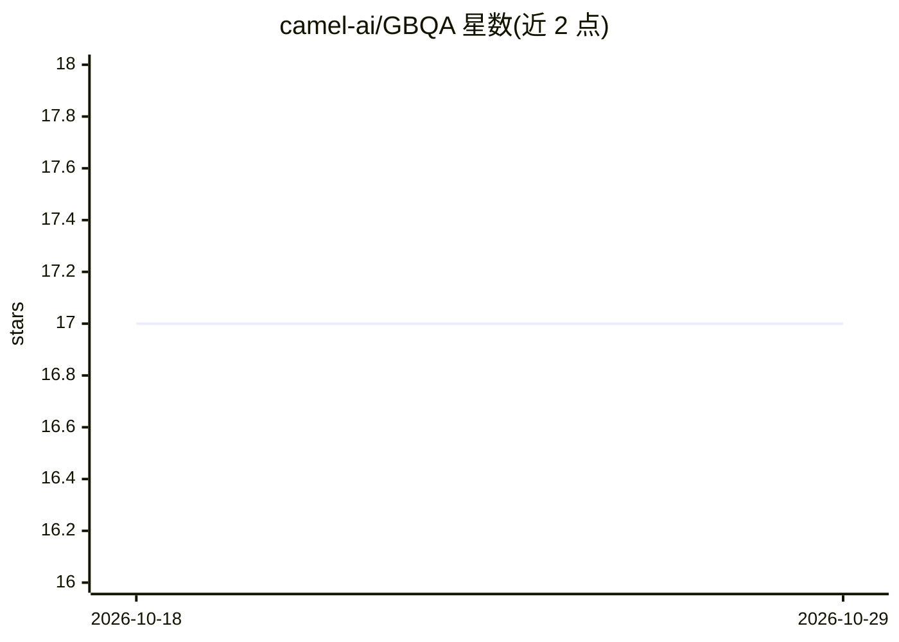

# camel-ai/GBQA

⭐ 17 · Python · Apache-2.0 · 推送 2026-06-25 · [GitHub](https://github.com/camel-ai/GBQA) · 组织维护

**面向 agent 的工业级质量保障评测基准，评测真实软件中的缺陷发现能力**

开源基准框架，将 agent 置于真实 GitHub 软件发布的隔离沙箱中，提供一条缺陷提示，让 agent 在终端或浏览器模式下探索运行环境、发现潜在缺陷并提交 issue 报告，由规则化的函数级验证器给出二元奖励分。每个实例是 Harbor 兼容任务包，沙箱可选用 Daytona 或 Modal 远程提供，支持最多 100 个任务的并行评测，并附带离线工具链从 GitHub 检索、筛选环境并导出任务包。需要 Python 3.12+，通过 pip 安装。

## 筛选速览

| 维度 | 判定 | 备注 |
|---|---|---|
| AI 角色 | `ai-ecosystem` | LLM/agent 周边工具 |
| 许可风险 | `permissive` | Apache-2.0 |
| 部署形态 | `library` | 以包/库形式分发 |
| 模型依赖 | — | README 未给出锁定关系 |
| 硬件要求 | — | 无带数字的原话,不猜 |
| 安装摩擦 | `low` | 无编译、无系统依赖或容器化 |
| 成熟度 | — | 结构信号不足 |

## 能力要点

- 每个实例指向真实 GitHub 发布版本，提供缺陷提示与基于规则的函数级验证
- 支持终端/浏览器/computer 交互模式与 Daytona、Modal 两种远程沙箱
- 可选用自研 GBQA harness 或 Harbor 内置 codex、claude-code 任务运行器
- 并行批量评测（最多 100 任务并发）与环境离线构建工具链

## 适用场景

- 评测 coding agent 在真实运行环境中发现缺陷的能力
- 批量并行运行基准任务并产出 reward 与评测载荷
- 从 GitHub 仓库自动检索并导出新的基准任务包

## 场景标签

`模型评测` · 领域:评测与运维

## 证据(README 行号)

> L3:  An open-source benchmark framework for running agents against real GitHub software releases, letting agents explore
> L11: The autonomous discovery of bugs remains a significant challenge in modern software development. Compared to code g
> L162: In Harbor benchmark runs, evaluation is performed automatically by the verifier

## 星数曲线

2026-10-18 17 → 2026-10-29 17（+0）

---
*卡片 v1 · prompt 1.4 · 生成 2026-10-29 · 置信度 high · 依据 README sha `8c8210473693` · [字段定义](../../DATASET.md)*
