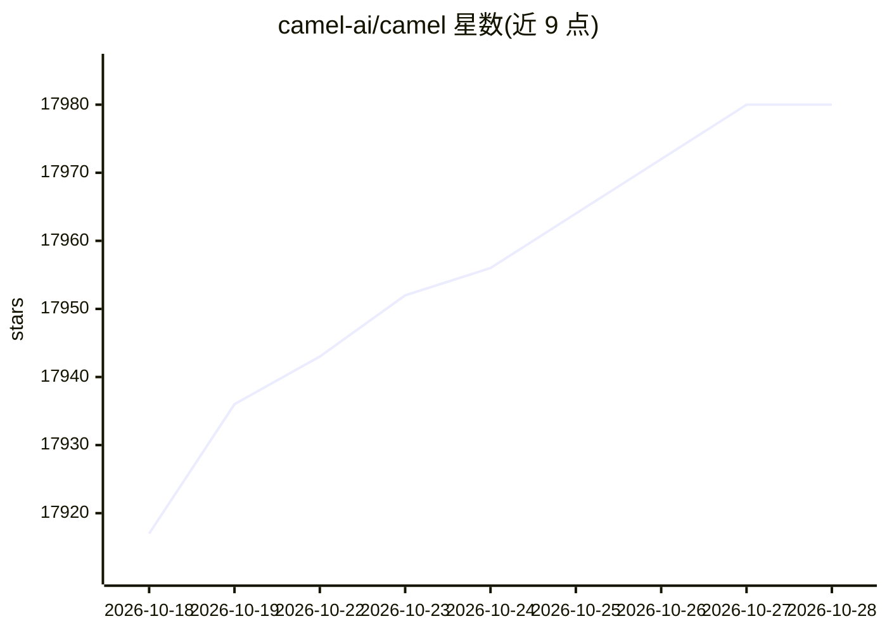

# camel-ai/camel

⭐ 17,980 · Python · Apache-2.0 · 推送 2026-10-27 · [GitHub](https://github.com/camel-ai/camel) · [官网](https://docs.camel-ai.org/)

**面向研究者的多智能体系统开源框架与数据生成工具**

CAMEL 是一个开源多智能体框架与社区，定位为研究 agent 行为与规模的实验平台。框架支持大规模 agent 系统仿真、状态记忆、角色扮演式多 agent 协作（Workforce）、多种基准测试与工具集成；提供 CoT、Self-Instruct 等合成数据生成模块，以及 Agents、Memory、Retrievers（RAG）、Benchmarks 等模块化组件。通过 PyPI 安装，附 Cookbooks 与文档，主要面向从事 Multi-Agent Systems 研究的科研群体，社区包含 100+ 研究者并附论文引用入口。

## 筛选速览

| 维度 | 判定 | 备注 |
|---|---|---|
| AI 角色 | `ai-native` | 本体是模型或模型工具 |
| 许可风险 | `permissive` | Apache-2.0 |
| 部署形态 | `library` | 以包/库形式分发 |
| 模型依赖 | — | README 未给出锁定关系 |
| 硬件要求 | — | 无带数字的原话,不猜 |
| 安装摩擦 | `low` | 无编译、无系统依赖或容器化 |
| 成熟度 | `idea` | |

## 动量与使用信号

- 维护:`active` — 距上次 push 6.0 天,年发版 43,233 位贡献者
- 涨星:近 1 天 **+16**(自 20261016 起算)
- 安装:pypi 包 `camel-ai` 月下载 42,975
- 平台:— · 协议:OPENAI-API / MCP

## 能力要点

- 支持最多 1M 规模 agent 的仿真与协调（框架设计目标）
- Role Playing 与 Workforce 多智能体协作机制
- CoT、Self-Instruct、Source2Synth 等合成数据生成模块
- 含 Memory、Retrievers、Benchmarks 等 13 个核心模块

## 适用场景

- 研究大规模多智能体系统的协作与涌现行为
- 用 agent 管线生成 CoT / 指令格式的合成训练数据
- 基于 RAG 与工具集成搭建任务自动化 agent

## 场景标签

`多智能体` `科研工具` · 领域:Agent 开发

## 证据(README 行号)

> L32:  🐫 CAMEL is an open-source community dedicated to finding the scaling laws of agents. We believe that studying thes
> L69: We are a community-driven research collective comprising over 100 researchers dedicated to advancing frontier resea
> L137: Installing CAMEL is a breeze thanks to its availability on PyPI. Simply open your terminal and run:

## 星数曲线

2026-10-18 17,917 → 2026-10-28 17,980（+63）

---
*卡片 v1 · prompt 1.4 · 生成 2026-10-18 · 置信度 high · 依据 README sha `b249e14498a8` · [字段定义](../../DATASET.md)*
