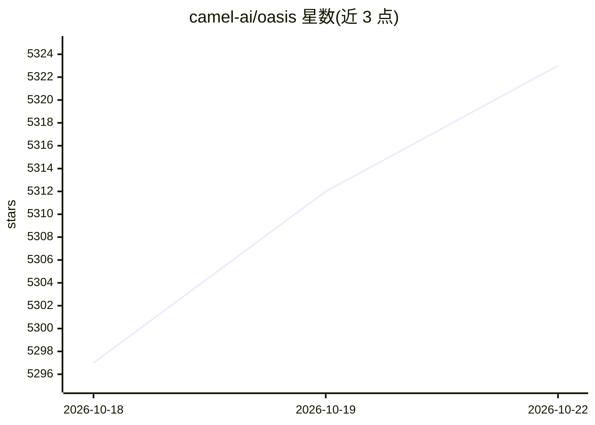

# camel-ai/oasis

⭐ 5,329 · Python · Apache-2.0 · 推送 2026-10-19 · [GitHub](https://github.com/camel-ai/oasis) · [官网](https://docs.oasis.camel-ai.org/) · 组织维护 · 中文 README

**给科研人员的百万级 LLM 智能体社交媒体模拟平台**

OASIS 是开源社交媒体模拟器，用大语言模型智能体模拟 Twitter/Reddit 等平台上最多一百万用户的行为，支持 23 种动作（关注、评论、转发等）、实时变化的动态社交网络、以及兴趣型和热榜型推荐算法。面向研究信息传播、群体极化、羊群效应等社会现象的科研用户。以 PyPI 包 camel-oasis 提供，需设置 OpenAI API key，README 给出 100 智能体/单时间步的 token 消耗参考；接口重构为 PettingZoo 风格，可自定义每个智能体的模型、工具与提示词。

## 筛选速览

| 维度 | 判定 | 备注 |
|---|---|---|
| AI 角色 | `ai-ecosystem` | LLM/agent 周边工具 |
| 许可风险 | `permissive` | Apache-2.0 |
| 部署形态 | `library` | 以包/库形式分发 |
| 模型依赖 | — | README 未给出锁定关系 |
| 硬件要求 | — | 无带数字的原话,不猜 |
| 安装摩擦 | `low` | 无编译、无系统依赖或容器化 |
| 成熟度 | — | 结构信号不足 |

## 能力要点

- 支持最多一百万智能体的社交媒体模拟
- 智能体可执行 23 种动作（关注、评论、转发等）
- 内置兴趣型与热榜型推荐算法
- 支持自定义每个智能体的模型、工具与提示词（PettingZoo 风格接口）

## 适用场景

- 研究社交平台上的信息传播与群体极化现象
- 大规模用户行为的模拟实验
- 基于模拟社交数据分析社会动力学

## 场景标签

`多智能体` `科研工具` · 领域:Agent 开发

## 证据(README 行号)

> L25: 🏝️ OASIS is a scalable, open-source social media simulator that incorporates large language model agents to realist
> L44: Agents can perform **23 actions**, such as following, commenting, and reposting, allowing for rich, multi-faceted i
> L148: - Support customization of each agent's models, tools, and prompts; refactor the interface to follow the PettingZo

## 星数曲线

2026-10-18 5,297 → 2026-10-22 5,323（+26）

---
*卡片 v1 · prompt 1.4 · 生成 2026-10-21 · 置信度 high · 依据 README sha `9112750317b5` · [字段定义](../../DATASET.md)*
