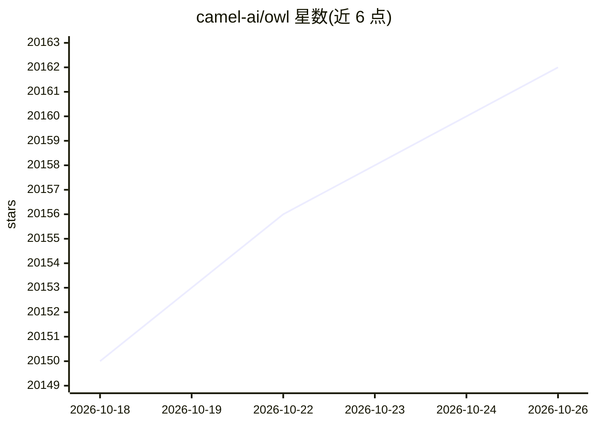

# camel-ai/owl

⭐ 20,162 · Python · 推送 2026-10-19 · [GitHub](https://github.com/camel-ai/owl) · 组织维护

**面向开发者的多智能体协作框架，自动化真实世界任务**

基于 CAMEL-AI Framework 构建的多智能体协作框架，通过动态 agent 交互完成真实世界任务自动化。内置在线搜索、浏览器自动化（Playwright）、多模态数据处理、文档解析（Word/Excel/PDF/PPT）与 Python 代码执行等工具包，并支持 MCP 协议接入工具。提供 uv/venv/conda/Docker 多种安装方式，运行需配置 LLM API key，模型需具备工具调用能力，多模态任务需多模态模型。提供 Web 界面与示例脚本，已开源训练数据集与模型检查点。

## 筛选速览

| 维度 | 判定 | 备注 |
|---|---|---|
| AI 角色 | `ai-native` | 本体是模型或模型工具 |
| 许可风险 | `none` | — |
| 部署形态 | `self-host` | docker 或自建部署 |
| 模型依赖 | locked-api |  |
| 硬件要求 | — | 无带数字的原话,不猜 |
| 安装摩擦 | `low` | 无编译、无系统依赖或容器化 |
| 成熟度 | — | 结构信号不足 |

## 动量与使用信号

- 维护:`active` — 距上次 push 6.0 天,年发版 0,39 位贡献者
- 涨星:近 1 天 **-3**(自 20261016 起算)
- 安装:npm 包 `@executeautomation/playwright-mcp-server` 月下载 58,051
- 平台:WINDOWS / LINUX / WEB · 协议:OPENAI-API / MCP / OLLAMA

## 能力要点

- 基于 Playwright 的浏览器自动化与多种搜索引擎接入
- 内置 MCP、代码执行、文档解析等大量工具包
- 支持多种 LLM 后端，含 Claude、Gemini、OpenRouter 等示例脚本
- 提供 Web 界面、Docker 镜像与社区 agent 挑战活动

## 适用场景

- 让多个 agent 协作完成联网检索、浏览器操作等自动化任务
- 解析本地文档并基于内容回答问题
- 对图像、视频、音频进行多模态分析
- 复现 GAIA benchmark 上的多智能体实验

## 场景标签

`多智能体` `浏览器自动化` `文档解析` `多模态` · 领域:Agent 开发

## 证据(README 行号)

> L27: 🦉 OWL is a cutting-edge framework for multi-agent collaboration that pushes the boundaries of task automation, buil
> L75: - **Browser Automation**: Utilize the Playwright framework for simulating browser interactions, including scrolling
> L231: - **Tool Calling**: OWL requires models with robust tool calling capabilities to interact with various toolkits. M

## 星数曲线

2026-10-18 20,150 → 2026-10-26 20,162（+12）

---
*卡片 v1 · prompt 1.4 · 生成 2026-10-18 · 置信度 mid · 依据 README sha `051259e1b3fa` · [字段定义](../../DATASET.md)*
