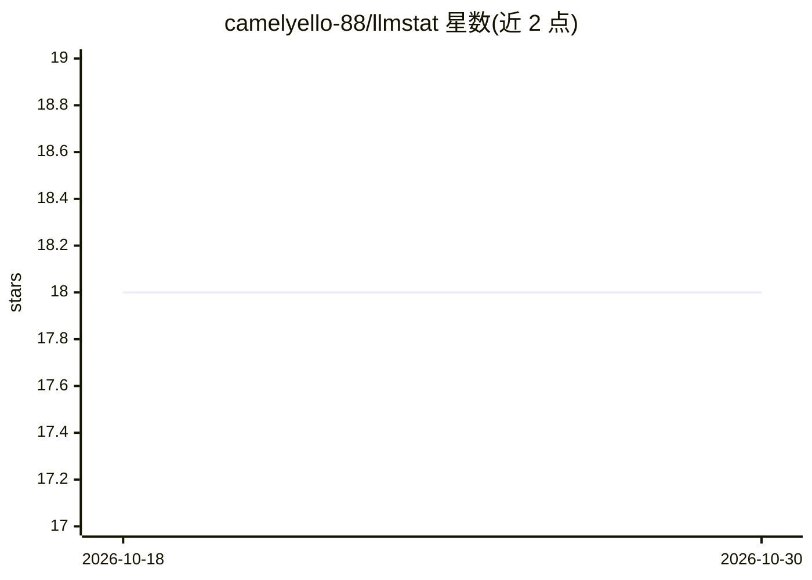

# camelyello-88/llmstat

⭐ 18 · Python · MIT · 推送 2026-06-25 · [GitHub](https://github.com/camelyello-88/llmstat) · 个人维护

**本地 LLM 代理：实时查看 token 用量与花费的终端面板**

面向独立开发者的 CLI 优先本地代理与观测工具：置于任意 OpenAI 兼容 API（OpenAI、DeepSeek、OpenRouter、vLLM、Ollama 等）之前，转发请求并从响应及 SSE 流中读取 usage 块，将 token 数、成本、延迟写入本地 SQLite（~/.llmstat/usage.db），再用 Textual TUI 展示。零代码改动，仅改 base URL；内置定价表并可用 ~/.llmstat/pricing.json 覆盖费率；支持 X-Llmstat-Project 头按项目分组。无云、无注册，MIT 许可。

## 筛选速览

| 维度 | 判定 | 备注 |
|---|---|---|
| AI 角色 | `ai-ecosystem` | LLM/agent 周边工具 |
| 许可风险 | `permissive` | MIT |
| 部署形态 | `library` | 以包/库形式分发 |
| 模型依赖 | local-ok | 支持本地模型 |
| 硬件要求 | — | 无带数字的原话,不猜 |
| 安装摩擦 | `low` | 无编译、无系统依赖或容器化 |
| 成熟度 | — | 结构信号不足 |

## 能力要点

- drop-in 代理，仅需修改 base URL，零代码改动
- 流式感知：从 SSE 分块读取 usage，而非仅普通响应
- 内置定价表，可用 pricing.json 覆盖费率（USD/1M tokens）
- 本地 SQLite 存储 + TUI 仪表盘，支持按项目头分组

## 适用场景

- 在使用多个 LLM API 时实时掌握 token 花费
- 自托管模型或个人网关前做轻量用量观测
- 一台机器跑多个应用时按项目分组查看支出

## 场景标签

`LLM 可观测性` `模型网关` · 领域:Agent 开发

## 证据(README 行号)

> L9: A modern, playful terminal dashboard that sits in front of **any OpenAI-compatible API**
> L95: your app ──▶ llmstat proxy ──▶ real LLM API

## 星数曲线

2026-10-18 18 → 2026-10-30 18（+0）

---
*卡片 v1 · prompt 1.4 · 生成 2026-10-29 · 置信度 high · 依据 README sha `59e39b2e1894` · [字段定义](../../DATASET.md)*
