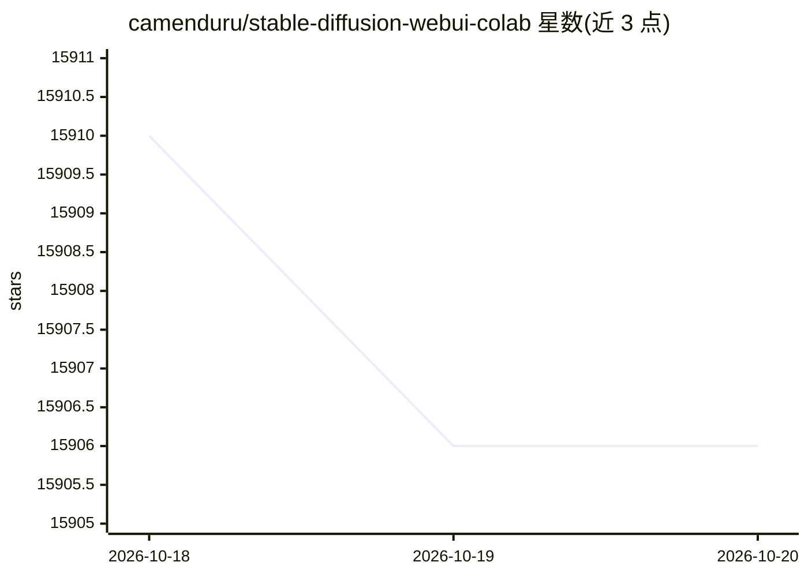

# camenduru/stable-diffusion-webui-colab

⭐ 15,906 · Jupyter Notebook · Unlicense · 推送 2025-12-16 · [GitHub](https://github.com/camenduru/stable-diffusion-webui-colab) · 个人维护

**在 Google Colab 上运行 Stable Diffusion WebUI 的笔记本合集**

为 Stable Diffusion WebUI 提供的一组 Google Colab 笔记本，提供 lite、stable、nightly 三种分支：stable 含 ControlNet v1.1，nightly 使用 PyTorch 2.0 并每日更新扩展。覆盖 txt2img、img2img、inpainting、DreamBooth 与 LoRA 训练（training 分支）等场景，并收录数十个社区模型的 Open In Colab 一键入口。README 声明该仓库已停止更新，建议转向 TostUI。

## 筛选速览

| 维度 | 判定 | 备注 |
|---|---|---|
| AI 角色 | `ai-ecosystem` | LLM/agent 周边工具 |
| 许可风险 | `permissive` | Unlicense |
| 部署形态 | `None` |  |
| 模型依赖 | — | README 未给出锁定关系 |
| 硬件要求 | — | 无带数字的原话,不猜 |
| 安装摩擦 | `low` | 无编译、无系统依赖或容器化 |
| 成熟度 | — | 结构信号不足 |

## 动量与使用信号

- 维护:`declining` — 距上次 push 306.1 天,年发版 0,14 位贡献者
- 涨星:近 1 天 **+0**(自 20261016 起算)
- 下载:GitHub Release 附件 累计 548,901(4 个 release)
- 平台:WEB · 协议:—

## 能力要点

- lite/stable/nightly 三种分支可选，stable 含 ControlNet v1.1，nightly 基于 PyTorch 2.0
- 提供数十个社区模型的 Open In Colab 一键运行入口
- 提供 DreamBooth 与 LoRA 训练分支及 Google Drive 安装分支
- 支持 stable-diffusion、waifu-diffusion、inpainting、v2 系列等多种模型

## 适用场景

- 在 Colab 上无需本地 GPU 运行 Stable Diffusion WebUI
- 为特定社区模型快速生成对应的 WebUI 运行环境
- 在 Colab 上进行 DreamBooth 或 LoRA 训练

## 场景标签

`图像生成` `微调` · 领域:内容生成

## 证据(README 行号)

> L5: # WebUI Restrictions Lifted! 🥳 Free WebUI is Back! 🔥 This repository is outdated and no longer receives updates. Ple
> L19: `lite` has a stable WebUI and stable installed extensions.
> L23: ## 🦒 Colab

## 星数曲线

2026-10-18 15,910 → 2026-10-20 15,906（-4）

---
*卡片 v1 · prompt 1.4 · 生成 2026-10-18 · 置信度 high · 依据 README sha `b5777572c6c5` · [字段定义](../../DATASET.md)*
