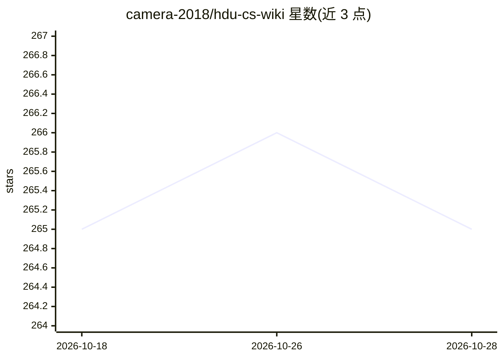

# camera-2018/hdu-cs-wiki

⭐ 265 · Vue · MIT · 推送 2026-06-07 · [GitHub](https://github.com/camera-2018/hdu-cs-wiki) · [官网](https://hdu-cs.wiki) · 组织维护 · 中文 README

**杭州电子科技大学计算机科学学习讲义 Wiki**

由 HDU 学长学姐、老师及计算机科协、孵化器、SRT、杭电助手、Vidar-Team 等团队协作编写的计算机科学学习讲义，内容覆盖人工智能入门、软件开发入门、计算机学习之道与路线等。面向初入大学的计算机相关学生，提供学习原则指引、帮助获取途径与交流群。托管于 Vercel 与腾讯云 CDN 提供在线阅读，采用 CC BY-NC-SA 3.0 CN 许可，持续接受社区参与撰写。

## 筛选速览

| 维度 | 判定 | 备注 |
|---|---|---|
| AI 角色 | `ai-knowledge` | 知识聚合/清单类 |
| 许可风险 | `permissive` | MIT |
| 部署形态 | `None` |  |
| 模型依赖 | — | README 未给出锁定关系 |
| 硬件要求 | — | 无带数字的原话,不猜 |
| 安装摩擦 | `low` | 无编译、无系统依赖或容器化 |
| 成熟度 | — | 结构信号不足 |

## 能力要点

- 覆盖人工智能入门、软件开发入门与计算机学习路线的讲义 Wiki
- 由学生组织、老师与多团队协办编写
- 提供国内腾讯云 CDN 与海外 Vercel 两个在线阅读节点
- 声明学习原则与获取帮助、社区交流渠道

## 适用场景

- 计算机专业新生规划学习路线与方向选择
- 查找人工智能与软件开发入门的中文学习资料
- 遇到学习问题时通过讲义社区与交流群求助

## 场景标签

`教程课程` · 领域:学习与行业

## 证据(README 行号)

> L43: 这份讲义由**zzm**发起，**计算机科协**，**孵化器**，**SRT**, **杭电助手**与 **Vidar-Team** 协办。参与讲义制作的有 hdu 的同学，老师，相关领域的大佬，覆盖了人工智能入门、软件开发入门，
> L26:  📚在线阅读（美国加利福尼亚、Vercel节点）

## 星数曲线

2026-10-18 265 → 2026-10-28 265（+0）

---
*卡片 v1 · prompt 1.4 · 生成 2026-10-22 · 置信度 high · 依据 README sha `2f40e9b1c130` · [字段定义](../../DATASET.md)*
