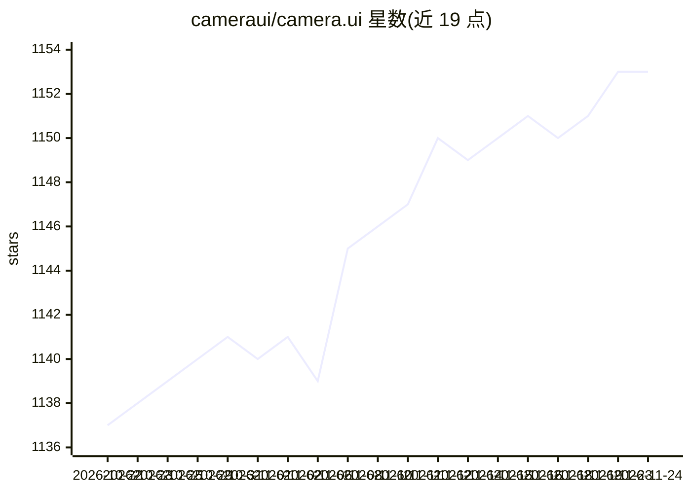

# cameraui/camera.ui

⭐ 1,153 · TypeScript · MIT · 推送 2026-11-19 · [GitHub](https://github.com/cameraui/camera.ui) · [官网](https://cameraui.com) · 个人维护

**本地优先的摄像头与 NVR 平台：自有硬件统一管理所有 IP 摄像头**

camera.ui 将 IP 摄像头整合到自托管系统：支持 RTSP/ONVIF/HTTP 协议接入及 Reolink、Eufy、Ring 品牌插件，提供自排布布局的实时查看、24 小时或事件触发录像（时间轴回放与 MP4 导出）。在自有硬件上运行物体、人脸与声音检测，支持区域、隐私遮罩与越线检测。服务器可运行于 macOS/Windows/Linux、Docker、Proxmox 或 Home Assistant，客户端覆盖桌面应用、浏览器、手机与 Apple TV。部分功能（ Episodes、自然语言搜索、视频推送通知等）标注为需要 camera.ui Pro。

## 筛选速览

| 维度 | 判定 | 备注 |
|---|---|---|
| AI 角色 | `ai-enhanced` | 去掉 AI 部分产品仍成立 |
| 许可风险 | `permissive` | MIT |
| 部署形态 | `self-host` | docker 或自建部署 |
| 模型依赖 | — | README 未给出锁定关系 |
| 硬件要求 | — | 无带数字的原话,不猜 |
| 安装摩擦 | `low` | 无编译、无系统依赖或容器化 |
| 成熟度 | — | 结构信号不足 |

## 能力要点

- RTSP/ONVIF/HTTP 接入与网络自动发现，支持品牌插件
- 自有硬件上运行物体、人脸与声音检测，支持区域与隐私遮罩
- 在 Apple Silicon、Intel、NVIDIA、AMD、Coral、Hailo 上自动选择硬件加速
- 与 HomeKit、Home Assistant、MQTT 集成的智能家居能力

## 适用场景

- 把家里多品牌 IP 摄像头统一接入一个自托管 NVR
- 在本地硬件上做移动物体与人脸检测告警
- 不用端口转发实现远程查看摄像头
- 通过 HomeKit 或 Home Assistant 联动摄像头事件

## 场景标签

`人脸识别` `目标检测` · 领域:感知与多模态

## 证据(README 行号)

> L19: camera.ui is the local-first camera and NVR platform. It turns your IP cameras into one system on your own hardware
> L25: - **Detection on your own hardware** for objects, faces and sounds, with zones, privacy masks and line crossing.
> L30: - **Smart home** with HomeKit, Home Assistant and MQTT.

## 星数曲线

2026-10-22 1,137 → 2026-11-24 1,153（+16）

---
*卡片 v1 · prompt 1.4 · 生成 2026-11-24 · 置信度 high · 依据 README sha `7a81c228b9c1` · [字段定义](../../DATASET.md)*
