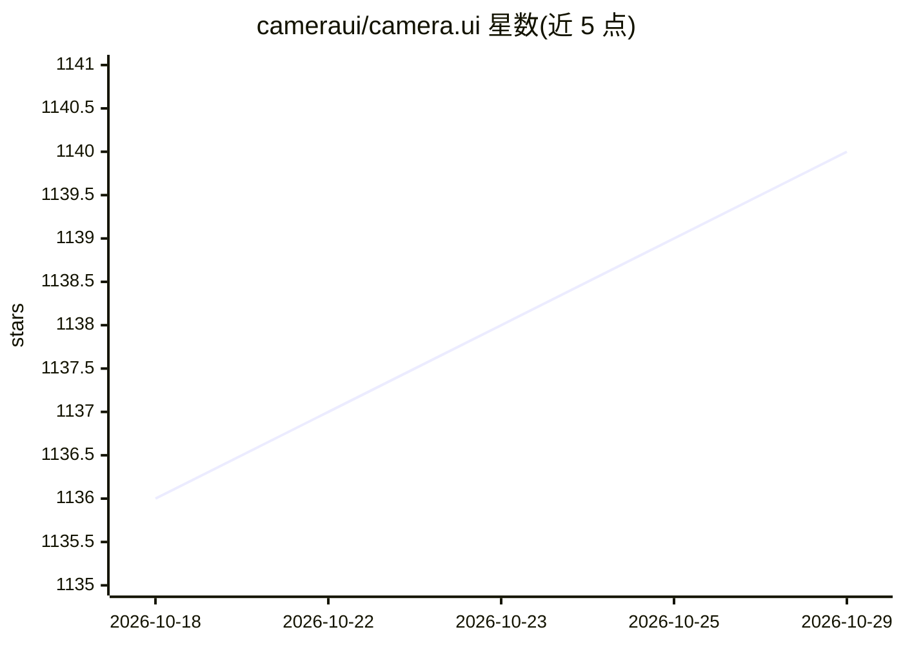

# cameraui/camera.ui

⭐ 1,140 · TypeScript · MIT · 推送 2026-10-28 · [GitHub](https://github.com/cameraui/camera.ui) · [官网](https://cameraui.com) · 个人维护

**自托管视频监控平台：直播、录像与本地 AI 检测**

面向自有安防摄像头的本地优先自托管平台，提供实时观看、24/7 录制、设备端 AI 检测、语义搜索、智能家居集成与推送通知，基于可扩展的插件生态构建，在用户自有硬件上运行，无强制云端。安装方式（桌面应用、Docker、Proxmox、裸机 Linux、移动应用）通过官方文档 docs.cameraui.com 说明，README 本身不含安装命令；在线演示标注为开发中。MIT 许可，2020 年起由 seydx 维护。

## 筛选速览

| 维度 | 判定 | 备注 |
|---|---|---|
| AI 角色 | `ai-enhanced` | 去掉 AI 部分产品仍成立 |
| 许可风险 | `permissive` | MIT |
| 部署形态 | `None` |  |
| 模型依赖 | — | README 未给出锁定关系 |
| 硬件要求 | — | 无带数字的原话,不猜 |
| 安装摩擦 | `low` | 无编译、无系统依赖或容器化 |
| 成熟度 | — | 结构信号不足 |

## 能力要点

- 直播观看与 24/7 录制，无强制云端，录像保留本地
- 设备端 AI 检测（含人脸/物体检测主题标签）与语义搜索
- 智能家居集成（HomeKit）与推送通知
- 可扩展插件生态，支持桌面应用/Docker/Proxmox/裸机 Linux/移动应用多种安装途径

## 适用场景

- 在自己硬件上搭建无强依赖云端的视频监控系统
- 对摄像头画面做人脸与物体检测并获得通知
- 将监控接入 HomeKit 等智能家居系统
- 通过语义搜索回查录像片段

## 场景标签

`人脸识别` `目标检测` `语义搜索` · 领域:知识与检索

## 证据(README 行号)

> L7: A self-hosted platform for your security cameras — live viewing, 24/7 recording\*, on-device AI detection, semantic 
> L11: Please follow the documentation at docs.cameraui.com — it covers installation (desktop app, Docker, Proxmox, bare-m

## 星数曲线

2026-10-18 1,136 → 2026-10-29 1,140（+4）

---
*卡片 v1 · prompt 1.4 · 生成 2026-10-21 · 置信度 mid · 依据 README sha `d59020397be3` · [字段定义](../../DATASET.md)*
