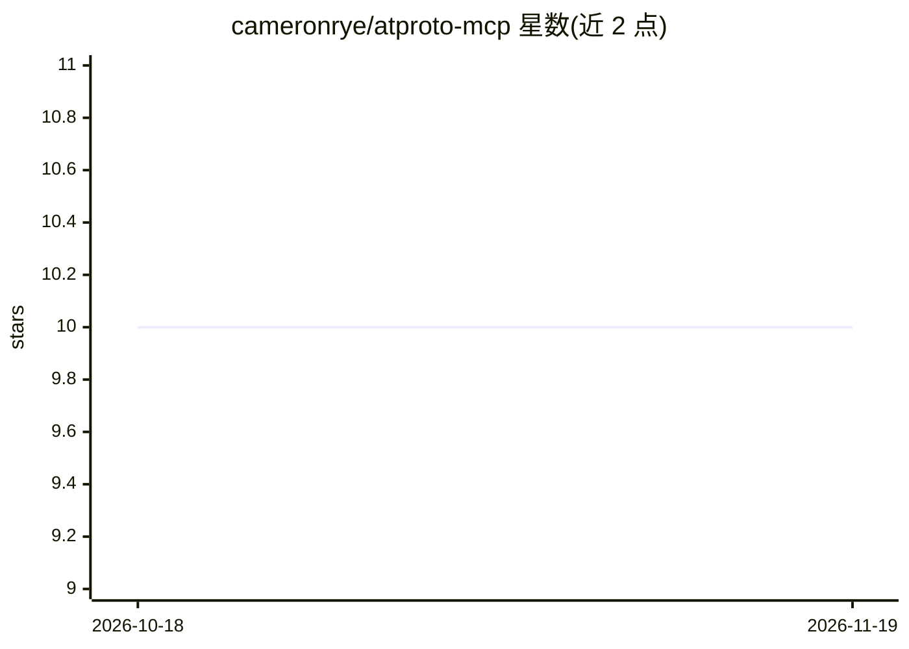

# cameronrye/atproto-mcp

⭐ 10 · TypeScript · MIT · 推送 2026-11-12 · [GitHub](https://github.com/cameronrye/atproto-mcp) · [官网](https://cameronrye.github.io/atproto-mcp/) · 个人维护

**让 LLM 客户端访问 AT Protocol/Bluesky 的 MCP 服务器**

基于 TypeScript 与官方 @atproto/api 实现的 MCP 服务器，作为 LLM 客户端与 AT Protocol 生态之间的桥接层，提供 51 个工具，覆盖资料查看、账号搜索、发帖/回复/点赞、私信、书签、列表管理、批量操作与互动分析等。支持免认证的公共数据模式（npx 直接运行）与应用密码认证的完整模式；OAuth 在路线图中尚未可用，实时 firehose 流式能力未实现为工具。面向 Claude Desktop 等 MCP 兼容客户端及部署/扩展该服务器的开发者。

## 筛选速览

| 维度 | 判定 | 备注 |
|---|---|---|
| AI 角色 | `ai-ecosystem` | LLM/agent 周边工具 |
| 许可风险 | `permissive` | MIT |
| 部署形态 | `self-host` | docker 或自建部署 |
| 模型依赖 | locked-api |  |
| 硬件要求 | — | 无带数字的原话,不猜 |
| 安装摩擦 | `low` | 无编译、无系统依赖或容器化 |
| 成熟度 | — | 结构信号不足 |

## 能力要点

- 51 个 MCP 工具覆盖读取、写作、私信、书签、审核与批量操作
- 免认证模式：npx atproto-mcp 即可访问公共数据
- 认证模式下支持发帖、时间线、通知、DM 等完整功能
- 内置对 AT Protocol 速率限制的遵循

## 适用场景

- 让 Claude Desktop 等客户端代为搜索和浏览 Bluesky 内容
- 通过自然语言代管 AT Protocol 账号的发帖与互动
- 为自有 LLM 应用部署一个 AT Protocol 能力网关

## 场景标签

 · 领域:LLM 基础设施/工具集成

## 证据(README 行号)

> L48: This MCP server acts as a bridge between LLM clients and the AT Protocol
> L103: This is an **MCP (Model Context Protocol) server** designed to be consumed by
> L88: - **Comprehensive Tools**: 51 MCP tools for social networking operations

## 星数曲线

2026-10-18 10 → 2026-11-19 10（+0）

---
*卡片 v1 · prompt 1.4 · 生成 2026-11-19 · 置信度 mid · 依据 README sha `a4358d99985e` · [字段定义](../../DATASET.md)*
