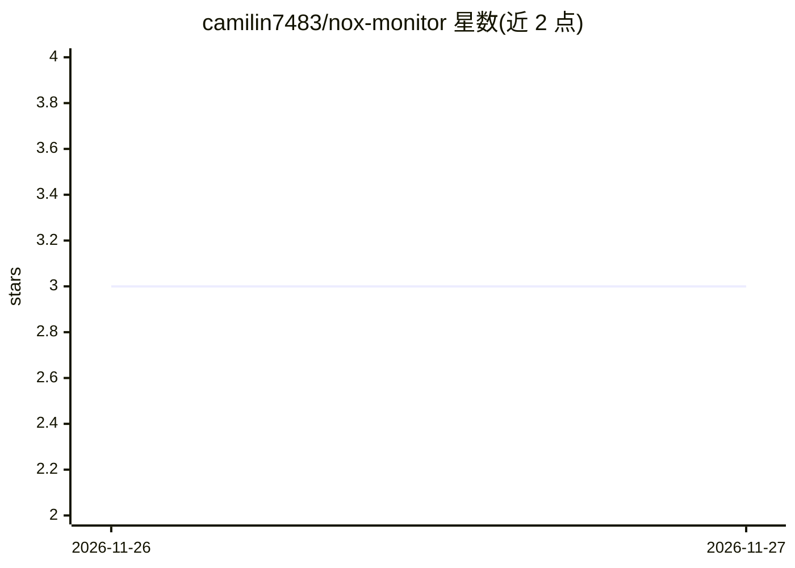

# camilin7483/nox-monitor

⭐ 3 · Python · 推送 2026-11-19 · [GitHub](https://github.com/camilin7483/nox-monitor) · 个人维护

**桌面端 WhatsApp AI 自动回复助手，支持本地或云端模型**

桌面应用（Windows/Linux x64，安装器与便携版）通过专用浏览器配置文件绑定 WhatsApp Web，自动化界面让配置的模型代答对话。用户可在监控面板测试模型、编辑系统提示词、添加文本参考源（按词条匹配检索片段入上下文）并授权哪些会话可回复。模型可接本地 Ollama/LM Studio，或填 OpenAI/Anthropic/Gemini/DeepSeek/OpenRouter 及 OpenAI 兼容 API 的密钥。数据存本地配置文件；当前云端生成与 Windows 原生 QR 绑定尚待验证，Windows 安装器无数字签名。

## 筛选速览

| 维度 | 判定 | 备注 |
|---|---|---|
| AI 角色 | `ai-native` | 本体是模型或模型工具 |
| 许可风险 | `none` | — |
| 部署形态 | `desktop` | 安装包/桌面程序 |
| 模型依赖 | local-ok | 支持本地模型 |
| 硬件要求 | — | 无带数字的原话,不猜 |
| 安装摩擦 | `low` | 无编译、无系统依赖或容器化 |
| 成熟度 | `idea` | |

## 能力要点

- 绑定 WhatsApp Web 后按授权会话自动回复，QR 会话在重启后保留
- 接 Ollama/LM Studio 本地模型或六类云端 API 密钥
- 系统提示词编辑与基于词条匹配的文本参考源检索
- 提供安装器与便携两种发行形态，包内含 Node.js 与 Python

## 适用场景

- 让本地模型代答指定的 WhatsApp 会话
- 个人桌面上统一测试多个 LLM 后端并切换激活
- 添加参考文本让回复基于自定义资料

## 场景标签

`浏览器自动化` `聊天机器人` · 领域:效率与自动化

## 证据(README 行号)

> L2:  Tu asistente de WhatsApp, desde una app de escritorio.
> L8: Nox vincula WhatsApp Web en un perfil de navegador dedicado. Desde el monitor puedes probar modelos, editar el promp
> L20: 2. En **Modelos**, conecta **Ollama** o **LM Studio**, o añade tu clave de **OpenAI**, **Anthropic**, **Gemini**, *

## 星数曲线

2026-11-26 3 → 2026-11-27 3（+0）

---
*卡片 v1 · prompt 1.4 · 生成 2026-11-26 · 置信度 high · 依据 README sha `6eb127b19717` · [字段定义](../../DATASET.md)*
