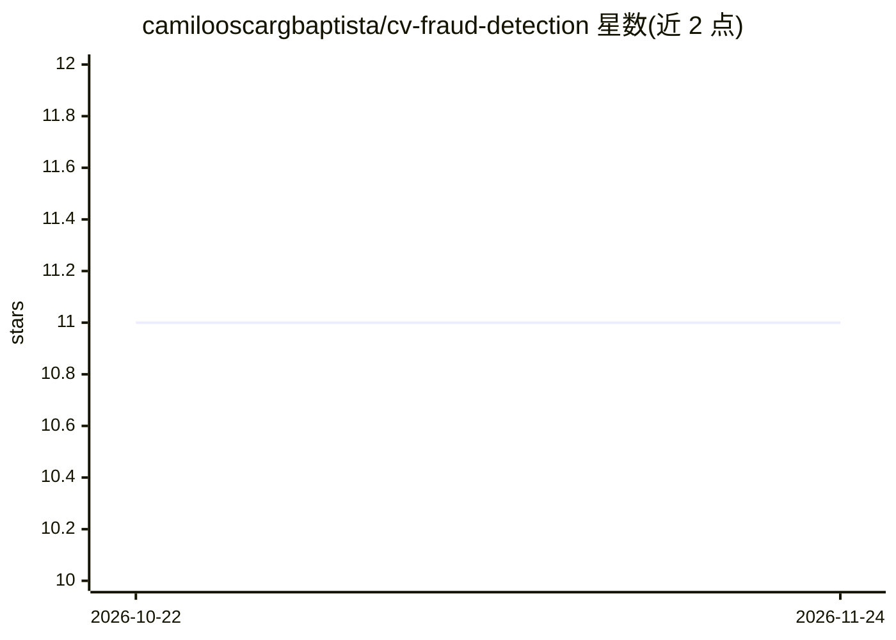

# camilooscargbaptista/cv-fraud-detection

⭐ 11 · Python · MIT · 推送 2026-03-18 · [GitHub](https://github.com/camilooscargbaptista/cv-fraud-detection) · 个人维护

**面向文档取证场景的图像篡改检测 CV 流水线**

端到端计算机视觉流水线，使用深度学习检测文档、图像与视频中的篡改。功能包括 CNN 分类器、错误级别分析与像素级分析（克隆/拼接/内容感知填充检测）、JPEG 压缩伪影分析、EXIF 元数据一致性校验，以及深度合成媒体初筛。支持 JPEG/PNG/TIFF/BMP/PDF 输入，兼容多个取证数据集，提供单文档与批量分析接口并生成报告。安装需 Python 3.10+，GPU 加速为可选项；标注了内存与显存配置。

## 筛选速览

| 维度 | 判定 | 备注 |
|---|---|---|
| AI 角色 | `ai-native` | 本体是模型或模型工具 |
| 许可风险 | `permissive` | MIT |
| 部署形态 | `None` |  |
| 模型依赖 | — | README 未给出锁定关系 |
| 硬件要求 | `gpu-8g` | |
| 安装摩擦 | `low` | 无编译、无系统依赖或容器化 |
| 成熟度 | — | 结构信号不足 |

## 能力要点

- CNN 分类、像素级克隆/拼接检测与错误级别分析结合
- EXIF 元数据、时间戳与软件签名一致性校验
- 支持 JPEG/PNG/TIFF/BMP/PDF 多格式与批量处理
- 兼容 NIST DFIG 等取证数据集用于训练

## 适用场景

- 验证文档图像是否被伪造或篡改
- 检测图像中的克隆、拼接与内容感知填充痕迹
- 对批量文档图像做取证筛查并输出报告

## 场景标签

`目标检测` · 领域:感知与多模态

## 证据(README 行号)

> L12: End-to-end pipeline for detecting manipulations in documents, images and videos using deep learning. This project p
> L16: - **Document Authenticity Verification**: Validate document integrity and detect forged elements
> L99: For training your own models, ensure images are labeled with ground truth manipulation masks.

## 星数曲线

2026-10-22 11 → 2026-11-24 11（+0）

---
*卡片 v1 · prompt 1.4 · 生成 2026-11-18 · 置信度 high · 依据 README sha `9c6d86601a7c` · [字段定义](../../DATASET.md)*
