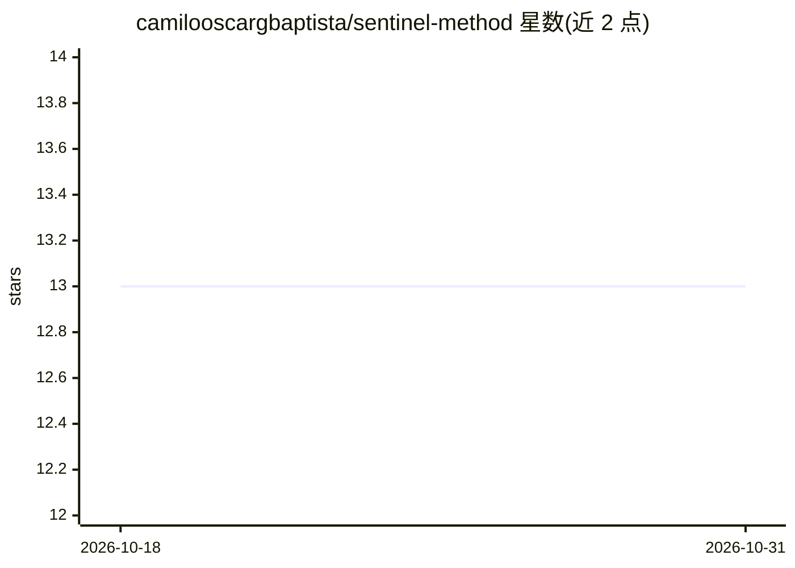

# camilooscargbaptista/sentinel-method

⭐ 13 · TypeScript · MIT · 推送 2026-10-26 · [GitHub](https://github.com/camilooscargbaptista/sentinel-method) · 个人维护

**面向 AI 生成代码的质量门禁框架，含 14 个校验器**

TypeScript/Node.js 编写的代码质量门禁工具：对 AI 生成的代码运行 14 个独立校验器（测试覆盖、安全扫描 OWASP/CWE、性能复杂度、可维护性 Halstead 指标、可访问性 WCAG 2.1 AA、i18n、类型安全等），并通过 ConsensusEngine 双子代理独立分析路径的一致性判定来减少误报。提供 CLI（npx sentinel validate）、编程 API 与自定义校验器插件系统，支持 .sentinelrc.json 配置、.gitignore 风格忽略、增量校验与结果缓存，并给出 GitHub Actions 与 GitLab CI 集成示例。限 MIT 许可，v3.0.0。

## 筛选速览

| 维度 | 判定 | 备注 |
|---|---|---|
| AI 角色 | `ai-ecosystem` | LLM/agent 周边工具 |
| 许可风险 | `permissive` | MIT |
| 部署形态 | `library` | 以包/库形式分发 |
| 模型依赖 | — | README 未给出锁定关系 |
| 硬件要求 | — | 无带数字的原话,不猜 |
| 安装摩擦 | `low` | 无编译、无系统依赖或容器化 |
| 成熟度 | — | 结构信号不足 |

## 能力要点

- 14 个独立校验器覆盖测试/安全/性能/可维护性/无障碍/i18n/类型安全等
- 双子代理独立验证 + 共识引擎过滤误报
- CLI、编程 API 与自定义校验器插件系统
- 增量校验与文件哈希结果缓存，附 GitHub Actions/GitLab CI 配置

## 适用场景

- 在 CI/CD 流水线中拦截 AI 生成代码的安全与质量问题
- 对现有代码库做 OWASP/CWE 安全扫描与复杂度度量
- 按 WCAG 与 i18n 标准检查前端代码

## 场景标签

`代码审查` · 领域:编码与开发

## 证据(README 行号)

> L25: AI generates code fast. But **fast != safe**. Every unchecked commit is a potential security breach, a performance 
> L29: Sentinel Method is a **production-grade quality gate** that intercepts AI-generated code and subjects it to 14 inde
> L153: ## CI/CD Integration

## 星数曲线

2026-10-18 13 → 2026-10-31 13（+0）

---
*卡片 v1 · prompt 1.4 · 生成 2026-10-31 · 置信度 high · 依据 README sha `97f69c6f20e3` · [字段定义](../../DATASET.md)*
